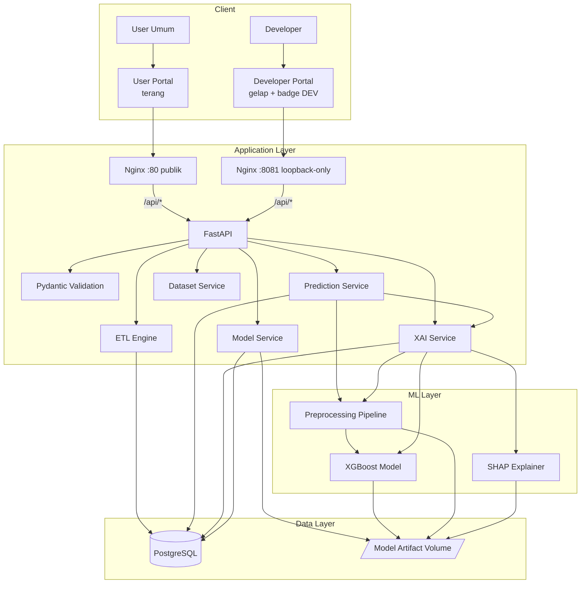
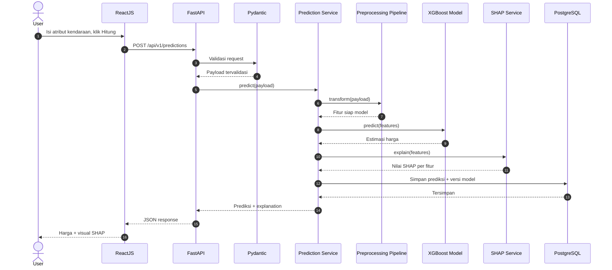
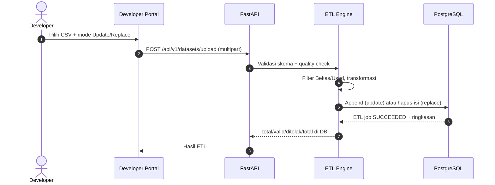

# OtoValue: Implementasi dan Evaluasi Sistem Prediksi Harga Mobil Bekas

Implementasi dan evaluasi model XGBoost untuk prediksi harga mobil bekas dengan
Explainable Artificial Intelligence menggunakan SHAP. Proof-of-concept end-to-end:
dataset dan metadata model di PostgreSQL, preprocessing reproducible, training
XGBoost, evaluasi MAE/RMSE/MAPE/R2, SHAP global/lokal, REST API prediksi +
explanation + dataset/ETL/model management, dua portal ReactJS terisolasi
(User Portal publik + Developer Portal loopback-only), seluruh stack
containerized dengan Docker.

## Metodologi (SDLC Waterfall)

Dokumentasi ini disusun mengikuti 7 fase Waterfall. Urutan fase = urutan baca.

| Fase | Cakupan dokumentasi |
|---|---|
| [Fase 1: Analisis Kebutuhan](#fase-1-analisis-kebutuhan) | Prinsip estimasi + SHAP, dua aktor, use-case UC1-UC12, batas scope |
| [Fase 2: Perancangan Sistem](#fase-2-perancangan-sistem) | Arsitektur layered, kontrak API `/api/v1`, ERD 6 tabel, topologi Nginx dua port |
| [Fase 3: Persiapan Data dan Machine Learning](#fase-3-persiapan-data-dan-machine-learning) | Dataset 22.679 baris, filter Bekas/Used, pipeline native categorical, artifact `xgb-v1` |
| [Fase 4: Implementasi Sistem](#fase-4-implementasi-sistem) | Backend FastAPI, dua portal ReactJS, PostgreSQL + seed, struktur repo |
| [Fase 5: Integrasi dan Pengujian](#fase-5-integrasi-dan-pengujian) | 5 suite `testing/`, metode eksekusi, matriks XAI, kriteria penerimaan |
| [Fase 6: Deployment](#fase-6-deployment) | Konfigurasi env passwordless, Docker Compose, troubleshooting |
| [Fase 7: Pemeliharaan dan Evaluasi](#fase-7-pemeliharaan-dan-evaluasi) | Keterbatasan CP dan hasil evaluasi GO |

## Daftar isi

- [Fase 1: Analisis Kebutuhan](#fase-1-analisis-kebutuhan)
- [Fase 2: Perancangan Sistem](#fase-2-perancangan-sistem)
- [Fase 3: Persiapan Data dan Machine Learning](#fase-3-persiapan-data-dan-machine-learning)
- [Fase 4: Implementasi Sistem](#fase-4-implementasi-sistem)
- [Fase 5: Integrasi dan Pengujian](#fase-5-integrasi-dan-pengujian)
- [Fase 6: Deployment](#fase-6-deployment)
- [Fase 7: Pemeliharaan dan Evaluasi](#fase-7-pemeliharaan-dan-evaluasi)

## Fase 1: Analisis Kebutuhan

Setiap prediksi harus bisa menjawab dua pertanyaan: **berapa estimasinya** dan
**mengapa sebesar itu**. Prinsip yang dipegang:

- **Satu pipeline preprocessing** dipakai saat training dan inference. Model tidak
  pernah melihat data mentah.
- **Model versioning**: setiap prediksi menyimpan `model_version`, jadi hasilnya
  selalu bisa ditelusuri ke artifact dan metrik yang menghasilkannya.
- **SHAP sebagai bagian dari inference**, bukan analisis offline. Backend menghitung
  kontribusi tiap fitur di dalam request flow `Input -> Prediction -> Explanation -> UI`,
  agar model tidak pernah dikirim ke browser.
- **API-first**: ReactJS hanya presentation layer. Semua inference lewat FastAPI,
  route handler tidak mengakses database langsung (service/repository layer).
- **Dua portal terpisah, bukan satu aplikasi gabungan**: User Portal untuk publik,
  Developer Portal sebagai konsol teknis di port tersendiri yang hanya di-bind ke
  loopback, sehingga user biasa tidak bisa mengaksesnya via jaringan.

Sistem memiliki tepat dua aktor:


Di luar scope CP: benchmarking multi-model (RF/LightGBM), LIME, auto-retraining
MLOps, deteksi drift, rekomendasi MCDM, scraping real-time, auth kompleks,
auto-deploy model setelah training, code editor/eksekusi arbitrary code dari portal.

## Fase 2: Perancangan Sistem

### 2.1 Ringkasan Topologi Sistem



### 2.2 Dekomposisi Arsitektur Codebase (Layered Architecture)

Codebase dirancang dengan arsitektur berlapis (*layered architecture*) yang memisahkan *presentation*, *gateway/routing*, *domain service*, *machine learning engine*, dan *data access*. Seluruh komponen mengikuti prinsip *Single Responsibility* dan minim ketergantungan silang:

```text
+-----------------------------------------------------------------------------------+
| 1. PRESENTATION LAYER (frontend/)                                                 |
|    - Dual SPA Bundle: User Portal (index.html) & Developer Portal (developer.html) |
|    - Adaptive Shells: DesktopView, MobileView (useWindowSize <= 768px), DevShell   |
|    - UI Components: VehicleForm, PredictionCard, ShapWaterfall, DataDashboard      |
|    - State & Client Services: usePrediction hook, api.js, formatCurrency.js       |
+-----------------------------------------------------------------------------------+
                                         |  HTTP / REST
                                         v
+-----------------------------------------------------------------------------------+
| 2. INGRESS & REVERSE PROXY LAYER (infra/nginx/)                                   |
|    - Port 80 (Publik): Serves User SPA + Proxy /api/ -> FastAPI (Blokir dev 404)  |
|    - Port 8081 (127.0.0.1 Loopback): Serves Dev SPA + Swagger /docs + Proxy /api/ |
+-----------------------------------------------------------------------------------+
                                         |  Reverse Proxy :8000
                                         v
+-----------------------------------------------------------------------------------+
| 3. API & WEB GATEWAY LAYER (backend/app/api/, backend/app/schemas/)              |
|    - App Lifespan: ModelManager warming + DB table init + auto-seed metadata      |
|    - Route Handlers: routes_health, routes_prediction, routes_model,              |
|                      routes_dataset, routes_etl, routes_developer, routes_stats   |
|    - Contract Validation: Pydantic schemas (PredictionRequest/Response, Stats)    |
+-----------------------------------------------------------------------------------+
                                         |  Invocations
                                         v
+-----------------------------------------------------------------------------------+
| 4. DOMAIN & SERVICE LAYER (backend/app/services/)                                 |
|    - ModelManager: Singleton in-memory loader untuk XGBoost artifact & preprocessor|
|    - PredictionService: Pipeline orkestrator (Input -> Preprocess -> Predict -> XAI)|
|    - ETLService: Streaming chunk parser CSV, data validator, batch DB ingestion   |
|    - StatsService: Agregasi analitik data listing mobil bekas untuk dashboard     |
+-----------------------------------------------------------------------------------+
                         |                                   |
                         v                                   v
+--------------------------------------+  +-----------------------------------------+
| 5. ML & EXPLAINABILITY (backend/ml/) |  | 6. REPOSITORY & PERSISTENCE (backend/db/|
|    - CategoricalPreprocessor         |  |    backend/app/repositories/)           |
|      (pandas.Categorical native)     |  |    - ListingRepository: bulk query/stats|
|    - Native XGBoost Booster Runtime  |  |    - ModelRepository: versions & metrics|
|    - In-Engine Tree SHAP Explainer   |  |    - PredictionRepository: JSONB audit  |
|      (pred_contribs=True, no SHAP lib|  |    - SQLAlchemy ORM 2.0 Engine          |
|       required at inference runtime) |  |    - PostgreSQL 16 (6 relational tables)|
+--------------------------------------+  +-----------------------------------------+
```

#### 1. Lapisan Frontend (`frontend/`)
- **Dual-SPA Multi-Page Architecture**: Dikonfigurasi melalui `vite.config.js` dengan dua entry point terisolasi: `index.html` (`src/main.jsx`) untuk User Portal dan `developer.html` (`src/developer/main.jsx`) untuk Developer Portal. Kode modul developer di-*chunk* terpisah (`developer-*.js`) sehingga tidak pernah bocor ke dalam bundle publik.
- **Adaptive Shell Switcher**: Hook `useWindowSize` mendeteksi *viewport width* secara reaktif (breakpoint 768px). Pada layar lebar (desktop), antarmuka menggunakan `DesktopView` dengan sidebar tetap. Pada layar kecil (mobile), antarmuka beralih ke `MobileView` dengan hamburger navigation dan *bottom navigation bar*.
- **Reusable Presentation Components**: Komponen visual utama (`VehicleForm`, `PredictionCard`, `ShapWaterfall`, `ShapBarChart`, `LoadingState`) digunakan secara konsisten baik pada User Portal maupun pada Developer Playground (`DevPlayground.jsx`).
- **Data Dashboard Visualizations**: `DataDashboard.jsx` menyajikan distribusi metrik mobil bekas (ringkasan, histogram harga, proporsi transmisi, perbandingan merek dan wilayah, serta histogram tahun) menggunakan visualisasi SVG native tanpa ketergantungan library grafik eksternal.
- **Client Service & State Management**: Modul `services/api.js` membungkus fetch API dengan penanganan timeout, `hooks/usePrediction.js` mengelola state siklus inferensi (idle, loading, success, error), dan `utils/formatCurrency.js` memformat representasi mata uang Rupiah.

#### 2. Lapisan Ingress & Reverse Proxy (`infra/nginx/`)
- **Port 80 (Public Gateway)**: Menyajikan static files User Portal (`index.html`), mem-proxy request rute `/api/` ke container backend (`fastapi:8000`), dan secara eksplisit memblokir request ke `developer.html` atau `/assets/developer*` dengan status HTTP 404.
- **Port 8081 (Loopback Developer Gateway)**: Dibatasi secara ketat hanya pada interface loopback `127.0.0.1`. Menyajikan Developer Portal (`developer.html`), dokumentasi Swagger UI (`/docs`, `/openapi.json`), dan mem-proxy `/api/`. Request ke `index.html` publik diblokir dengan status HTTP 404.

#### 3. Lapisan API & Web Gateway (`backend/app/api/`, `backend/app/schemas/`)
- **Lifespan Lifecycle Controller (`backend/app/main.py`)**: Mengelola inisialisasi aplikasi secara tersentralisasi saat proses startup: memastikan tabel PostgreSQL terbuat via SQLAlchemy, memuat model ML aktif ke memory lewat `ModelManager`, dan mengeksekusi auto-seed metadata dataset/model/listing (bila diaktifkan via `SEED_ON_STARTUP`).
- **Modular Route Handlers**:
  - `routes_health.py`: Healthcheck endpoint (`GET /health`) yang memverifikasi kesiapan model aktif.
  - `routes_prediction.py`: Endpoint inferensi tunggal (`POST /predictions`) dan pembacaan detail riwayat prediksi (`GET /predictions/{id}`).
  - `routes_model.py`: Endpoint informasi model aktif (`GET /models/active`) dan katalog seluruh versi model (`GET /models`).
  - `routes_dataset.py`: Multipart upload streaming dataset CSV (`POST /datasets/upload`) serta metadata dataset (`GET /datasets`, `GET /datasets/{id}`).
  - `routes_etl.py`: Riwayat audit eksekusi ETL (`GET /etl/jobs`).
  - `routes_developer.py`: Agregasi ringkasan diagnostik backend, database, model, dan status ETL (`GET /developer/overview`).
  - `routes_stats.py`: Endpoint metrik statistik agregat listing mobil bekas (`GET /stats/dataset`).
- **Schema Contracts (`backend/app/schemas/`)**: Pydantic models mendefinisikan validasi batas ketat (`1930 <= year <= 2026`, `km >= 0`, `price >= 0`) dan serialisasi JSON terstruktur.

#### 4. Lapisan Domain & Service (`backend/app/services/`)
- **`ModelManager` (`model_manager.py`)**: Singleton in-memory cache untuk artefak model XGBoost. Membaca file `model.json`, `preprocessing.joblib`, dan skema fitur sekali saat startup. Tidak melakukan disk I/O ulang saat melayani request inferensi.
- **`PredictionService` (`prediction_service.py`)**: Mengorkestrasi alur inferensi: memvalidasi fallback kilometer (`km_1` atau `km_2`), mentransformasi input ke format DataFrame berkategori native, memanggil XGBoost Booster untuk memprediksi harga, mengekstrak penjelasan pohon native, memetakan kembali kontribusi ke 6 fitur semantik, dan menyimpan log prediksi ke database secara best-effort tanpa menghambat respons pengguna.
- **`ETLService` (`etl_service.py`)**: Mengimplementasikan pemrosesan streaming batch untuk file CSV multipart tanpa memuat seluruh file ke RAM. Melakukan validasi header wajib, sanitasi batas numerik/kategorikal, pemfilteran listing `Bekas`/`Used`, serta mendukung mode ingestion `update` (append) dan `replace` (pengosongan data lama dataset lalu pengisian baru).
- **`StatsService` (`stats_service.py`)**: Menghitung analitik teragregasi langsung dari tabel listing database (total unit, mean/median/min/max harga, distribusi transmisi, ranking merek, dan sebaran tahunan).

#### 5. Lapisan Machine Learning & XAI (`backend/app/ml/`, `artifacts/models/`)
- **`CategoricalPreprocessor` (`categorical_preprocessor.py`)**: Mempertahankan tipe data kategori asli pandas (`pandas.Categorical`) untuk fitur berkardinalitas tinggi seperti `brand_type` (> 2.000 kategori). Menghindari ledakan dimensi One-Hot Encoding dan distorsi ordinal encoding. Menangani kategori baru saat inferensi dengan memetakannya ke *missing category* yang didukung langsung oleh algoritma pohon XGBoost.
- **Native In-Engine Tree SHAP**: Penjelasan fitur dihitung langsung di backend menggunakan fitur native pohon XGBoost `Booster.predict(..., pred_contribs=True)`. Menghasilkan *base value* dan nilai kontribusi per fitur secara aditif ($\text{Base Value} + \sum \phi_i = \text{Prediksi}$). Kecepatan komputasi berada pada orde milidetik dan tidak membutuhkan library `shap` pada saat runtime inferensi.
- **Versioned Artifact Bundle**: Disimpan per versi pada direktori `artifacts/models/xgboost/<version>/` yang mencakup 6 file lengkap: `model.json` (bobot model), `preprocessing.joblib` (state preprocessor), `feature_schema.json` (definisi fitur dan tipe data), `metrics.json` (skor MAE/RMSE/MAPE/R2 per split), `training_config.json` (parameter training dan random seed), serta `shap_config.json` (konfigurasi atribut explainability).

#### 6. Lapisan Repository & Persistensi Data (`backend/app/repositories/`, `backend/app/db/`)
- **Repository Pattern**: Mengisolasi logika query basis data dari lapisan route dan service:
  - `ListingRepository`: Pengambilan data listing teragregasi, query berfilter, dan operasi *bulk insert* batch.
  - `ModelRepository`: Pengambilan metadata versi model aktif dan metrik evaluasi per split.
  - `PredictionRepository`: Penyimpanan log inferensi dan riwayat prediksi dengan field `input_payload` dan `shap_payload` berbasis JSONB untuk kemudahan audit trail.
- **Database Engine & ORM**: Berbasis SQLAlchemy 2.0 dengan driver `psycopg` (PostgreSQL 16) menggunakan connection pooling dan session lifecycle `get_db()`.
- **Relational ERD Tables**: Terdiri dari 6 tabel: `datasets`, `etl_jobs`, `listings`, `model_versions`, `model_metrics`, dan `predictions`.

#### 7. Pipeline ML Offline & Reproducibility (`ml/scripts/`)
- **`profile_dataset.py`**: Skrip CLI untuk memprofiling dataset mentah `dataset.csv`, menganalisis korelasi redundansi `KM_1` dan `KM_2`, memfilter baris listing `Bekas` dan `Used` (21.553 baris), dan mengekspor dataset bersih ke `data/processed/`.
- **`train_baseline.py`**: Skrip pelatihan reproducible mandiri dengan random seed 42, pembagian 80/20 train/test, pelatihan XGBoost native categorical, evaluasi metrik performa, dan pembuatan paket artefak terversi.
- **`seed_db.py`**: Skrip populasi database independen untuk menginisialisasi metadata model, metrik evaluasi, dan listing data awal ke PostgreSQL.

### 2.3 Alur Eksekusi (Execution Flows)

Alur prediksi + penjelasan:



Alur upload dataset + ETL (Developer Portal):



### 2.4 Topologi Deployment & Isolasi Jaringan

Deploy (sesuai `docker-compose.yml`):

```text
User biasa (jaringan)
  |
  v
http://<host>              (nginx :80, publik)
  |-- /        -> User Portal (frontend :80, index.html)
  |-- /api/    -> backend (FastAPI + Uvicorn :8000)
  (developer.html + chunk /assets/developer* diblokir 404 di port ini)

Developer (localhost / SSH tunnel)
  |
  v
http://localhost:8081      (nginx :8081, bind 127.0.0.1 saja)
  |-- /            -> Developer Portal (frontend :8081, developer.html)
  |-- /api/        -> backend (FastAPI :8000)
  |-- /docs        -> Swagger UI
  |-- /openapi.json -> OpenAPI contract

backend -> postgres :5432 (tidak diekspos ke host; volume postgres_data)
backend -> artifact model (bind-mount read-only)
pgAdmin langsung di :5050 (tanpa login, mode passwordless)
```

| Service  | Image / Build        | Akses host                        | Peran                                   |
|----------|----------------------|-----------------------------------|-----------------------------------------|
| nginx    | `nginx:alpine`       | `:80` publik, `:8081` loopback    | Reverse proxy dua port                  |
| frontend | build `./frontend`   | via nginx (`:80`/`:8081` internal)| Dua entry: `index.html` + `developer.html` |
| backend  | build `./backend`    | via nginx                         | FastAPI + XGBoost + SHAP + ETL          |
| postgres | `postgres:16-alpine` | -                                 | Database + metadata + log               |
| pgadmin  | `dpage/pgadmin4:9`   | `:5050`                           | Administrasi database                   |

## Fase 3: Persiapan Data dan Machine Learning

### Dataset dan keputusan data

`dataset.csv`: 22.679 baris, 14 kolom, target `price`, tanpa missing value.

| Jenis kolom | Kolom |
|---|---|
| Kategorikal | `brand` (51), `brand_type` (2.002), `machine_type`, `location` (22), `listing__type` |
| Numerik | `year` (1975-2025), `KM_1`, `KM_2` |
| Teks mentah | `item`, `ellipsize`, `listing__excerpt` |

Keputusan penelitian (diimplementasikan di `ml/scripts/` dan dipakai ulang oleh
ETL backend):

- Eksperimen utama hanya listing `Bekas` + `Used` (21.553 baris). `Baru` dibuang.
- `Unnamed: 0` = index, bukan fitur.
- `KM_1` dan `KM_2` berkorelasi 0,999 (redundan), dipakai satu: `km_1`.
- Kolom teks mentah tidak dipakai di baseline (scope + cegah leakage).
- `brand_type` high-cardinality dipertahankan sebagai dtype kategori dan diproses oleh
  native categorical XGBoost (`enable_categorical=true`), tanpa One-Hot Encoding,
  Ordinal Encoding, atau target leakage.

Dataset baru masuk **hanya** lewat upload Developer Portal + ETL (validasi skema,
quality check, filter `Bekas`/`Used`), dengan dua mode: **Update** (append, data
lama tetap ada) atau **Replace** (hapus semua data lama, isi data baru).
Batas upload via env `MAX_UPLOAD_MB` (default 50).

### Pipeline ML dan artifact model

```text
Raw CSV -> Filter Used/Bekas -> Quality Check -> Split 80/20 (seed 42)
  -> CategoricalPreprocessor -> XGBoost (enable_categorical=true)
  -> Evaluasi -> Artifact
```

Fitur: `year` dan `km_1` numerik; `brand`, `machine_type`, `location`, dan
`brand_type` dipertahankan sebagai `pandas.Categorical`. Kategori baru saat
inference dipetakan menjadi missing category dan tetap dapat diprediksi oleh
XGBoost native categorical.

Model aktif `xgb-v1` (`artifacts/models/xgboost/xgb-v1/`), metrik test:

| MAE | RMSE | MAPE | R2 |
|---|---|---|---|
| 25.446.042 | 52.997.228 | 8,40% | 0,9371 |

Konvensi artifact per versi (`model.json`, `preprocessing.joblib`,
`feature_schema.json`, `metrics.json`, `training_config.json`, `shap_config.json`):
satu `model_version` mengikat model + preprocessing + skema + metrik + konfigurasi
SHAP, sehingga inference selalu reproducible. Training bersifat offline/manual:

```bash
python ml/scripts/profile_dataset.py   # profiling + filter -> data/processed/
python ml/scripts/train_baseline.py    # latih + evaluasi + simpan artifact
```

Penjelasan lokal memakai kontribusi pohon native XGBoost
(`Booster.predict(pred_contribs=True)`), diagregasi kembali ke 6 fitur asli.
Terverifikasi aditivitasnya: `base_value + sum(shap) = prediksi` (residu Rp88
akibat pembulatan float32). Tidak butuh lib `shap` saat inference.

## Fase 4: Implementasi Sistem

### Backend (FastAPI)

Base URL `/api/v1`. Model dan preprocessing dimuat **sekali** saat startup
(lifespan), tidak reload per request. Inference dibatasi timeout (`INFERENCE_TIMEOUT_S`,
respons 504 bila lewat). Startup otomatis membuat tabel dan seed metadata
dataset + versi model + metrik. Kode:
`backend/app/{api,core,db,ml,repositories,schemas,services}`.

| Method | Endpoint | Keterangan |
|---|---|---|
| GET | `/health` | `{"status": "ok", "model_version": "xgb-v1"}` (503 bila model belum termuat) |
| POST | `/predictions` | Prediksi + explanation, log ke PostgreSQL (best-effort) |
| GET | `/predictions/{id}` | Detail input + prediksi + explanation |
| GET | `/models/active` | Metadata model aktif + metrik per split |
| GET | `/models` | Daftar seluruh versi model + metrik (Model Management) |
| POST | `/datasets/upload` | Upload CSV multipart (`file` + `mode` update/replace), langsung ETL |
| GET | `/datasets` | Daftar dataset + 5 ETL job terakhir per dataset |
| GET | `/datasets/{id}` | Detail dataset + 20 riwayat ETL |
| GET | `/etl/jobs` | Riwayat ETL job (`?limit`, default 20) |
| GET | `/developer/overview` | Agregat backend + database + dataset/model aktif + ETL readiness |
| GET | `/stats/dataset` | Statistik database listings (total, harga, tahun, km, merek, lokasi, histogram; filter opsional `brand`, `location`, `machine_type`, `year_min`, `year_max`) |

Contoh request prediksi:

```json
{"brand": "Honda", "brand_type": "City 1.5 E Sedan", "machine_type": "Automatic",
 "location": "DKI Jakarta", "year": 2021, "km_1": 45000, "km_2": 45000}
```

Contoh response:

```json
{"prediction_id": "uuid", "model_version": "xgb-v1", "predicted_price": 258148416,
 "currency": "IDR",
 "explanation": {"base_value": 313370208,
   "features": [{"feature": "year", "value": 2021, "shap_value": 25150464}] } }
```

Validasi Pydantic: `1930 <= year <= 2026`, `0 <= km <= 1.000.000` (batas dari
distribusi data, dapat diubah via env `MIN_YEAR`/`MAX_YEAR`/`MAX_KM`), minimal
satu dari `km_1`/`km_2` terisi, kategori asing ditoleransi (tetap memprediksi).
Training tidak diekspos sebagai endpoint (offline via `ml/scripts/`, tanpa
auto-retraining dan tanpa auto-deploy).

### Developer Portal

Konsol teknis di `http://localhost:8081` (loopback-only), entry `developer.html`,
shell gelap + badge DEV, 6 modul dengan navigasi sendiri:

| Modul | Rute | Fungsi |
|---|---|---|
| Business/System Overview | `#/developer` | Status backend, database, dataset/model aktif, ETL readiness |
| Dataset Management | `#/developer/datasets` | Upload CSV + pilihan **Update** (tambah) / **Replace** (ganti semua + warning), daftar dataset |
| ETL Management | `#/developer/etl` | Tabel riwayat job: file, mode, status, total/valid/ditolak |
| Model Management | `#/developer/models` | Versi model, badge ACTIVE, metrik MAE/RMSE/MAPE/R2 per split |
| Prediction Playground | `#/developer/playground` | Uji prediksi + SHAP memakai komponen yang sama dengan User Portal |
| API Explorer | `#/developer/api` | Katalog endpoint + tombol ke Swagger UI (`/docs`, same-origin) |

Isolasi dari user biasa berlapis: port berbeda + bind loopback, entry build
terpisah (bundle user terbukti bersih dari kode developer), nginx memblokir
silang (`developer.html` 404 di port 80, `index.html` 404 di port 8081), tanpa
link dari User Portal ke Developer Portal, dan `noindex, nofollow`.

### User Portal (ReactJS)

Halaman `Beranda` (penjelasan + metrik model live dari API), `Data` (dashboard
statistik database listings: tata letak lebar di desktop dan ringkas di mobile,
ringkasan, histogram harga, perbandingan transmisi, merek dan lokasi berdampingan,
histogram tahun penuh, semuanya dengan tooltip hover/sentuh/fokus dan
scroll-reveal), dan `Hitung estimasi`
(formulir -> kartu hasil -> grafik SHAP). Komponen: `VehicleForm`,
`PredictionCard`, `ShapWaterfall`, `ShapBarChart`, `LoadingState`, plus
`services/api.js`, `hooks/usePrediction.js`, `utils/formatCurrency.js`.

Aturan yang dipegang: styling Tailwind CSS, satu aplikasi dua shell via hook
`useWindowSize` (batas 768px): desktop dengan Sidebar statis, mobile dengan
Hamburger Menu + Bottom Navigation Bar, tanpa emoji (ikon SVG inline), hasil
disebut **estimasi model** bukan harga pasti, opsi dropdown dari dataset asli
(47 merek, 21 lokasi), semua angka dari API, state kosong/loading/error
informatif (sebab + aksi), responsif dan keyboard-only friendly (skip link,
kontrol native, fokus terlihat). API base via `VITE_API_URL`, default
same-origin `/api/v1`. Bundle user tidak memuat rute/navigasi developer.

### Database (PostgreSQL + pgAdmin)

Enam tabel sesuai ERD: `datasets` (metadata + status + counter valid/ditolak),
`etl_jobs` (riwayat eksekusi ETL: mode, file, total/valid/ditolak, status),
`listings` (observasi mobil bekas), `model_versions` (mini model registry, satu
baris aktif), `model_metrics` (metrik per split: test/validation), `predictions`
(`input_payload` + `shap_payload` sebagai JSONB untuk audit trail).

Seed metadata otomatis saat backend start. Tabel `listings` ikut di-seed otomatis
bila kosong dan file CSV tersedia (`SEED_CSV_PATH`, di compose ter-mount dari
`./data/processed`; bila belum ada, fallback ke `SEED_FALLBACK_CSV_PATH` =
`dataset.csv` mentah yang ikut ter-mount di `/app/dataset.csv`). Matikan dengan `SEED_ON_STARTUP=false`. Seed manual
penuh (dataset + listings + model + metrik):

```bash
# Postgres harus dapat dijangkau, mis. port-forward atau DATABASE_URL lokal
set DATABASE_URL=postgresql+psycopg://app@HOST:5432/carprice
python ml/scripts/seed_db.py
```

pgAdmin tanpa login di `http://localhost:5050`, server `carprice (local)` sudah
terdaftar otomatis.

### Struktur repo

```text
frontend/                  # ReactJS, dua entry: index.html (user) + developer.html
  src/
    layouts/               # DesktopView/MobileView (user) + DeveloperShell
    developer/             # devNav.js + main.jsx (entry developer)
    components/            # prediction (dipakai ulang playground), nav, shell user
    pages/                 # Home/Prediction/DataDashboard + developer/ (6 modul)
    services/hooks/utils/  # api.js, usePrediction.js, formatCurrency.js
  nginx.conf               # dua server: :80 user, :8081 developer (+ blokir silang)
backend/                   # FastAPI (app/api, core, db, repositories, schemas, services)
  app/api/                 # routes_health/prediction/model/dataset/etl/developer/stats
  app/services/            # prediction_service, model_manager, stats_service, etl_service
testing/                   # 5 skrip pengujian flat (run_all.py + 1..5, tanpa subdirektori)
  run_all.py               # master orchestrator
  1_data_validation.py     # Suite 1
  2_unit_testing.py        # Suite 2
  3_integration_testing.py # Suite 3
  4_functional_testing.py  # Suite 4
  5_model_xai_validation.py # Suite 5
ml/scripts/                # profile_dataset, train_baseline, seed_db
data/processed/            # hasil filter (regenerable, di-ignore git)
artifacts/models/          # artifact versioned xgb-v1
infra/nginx/               # reverse proxy dua port (80 publik + 8081 loopback)
infra/pgadmin/             # servers.json praregistrasi
docker-compose.yml
.env.example
```

## Fase 5: Integrasi dan Pengujian

Sumber kebenaran dokumentasi pengujian adalah bagian ini. Tidak ada `README.md`
terpisah di dalam `testing/` — seluruh panduan suite terpusat di sini.

```text
testing/
├── run_all.py                  # Master test orchestrator (menjalankan kelima suite)
├── 1_data_validation.py        # Suite 1: Data Validation & ETL Rules
├── 2_unit_testing.py           # Suite 2: Unit Testing, Static Analysis, & Utility
├── 3_integration_testing.py   # Suite 3: Integration Testing & Security Boundary
├── 4_functional_testing.py    # Suite 4: Functional Testing & Frontend Quality Gate
└── 5_model_xai_validation.py  # Suite 5: Model Artifacts & Tree SHAP Validation
```

### Suite 1: Data Validation (`testing/1_data_validation.py`)
- Memvalidasi dataset mentah `dataset.csv`: 22.679 baris, 14 kolom, 0 missing value, 21.553 listing Bekas/Used (1.126 listing Baru dibuang).
- Memverifikasi korelasi `KM_1` dan `KM_2` (~0.999 redundansi).
- Menguji aturan penolakan data ETL (`REQUIRED` headers, tahun di luar batas, KM negatif/ekstrem, harga negatif, kategori kosong/whitespace).

### Suite 2: Unit Testing (`testing/2_unit_testing.py`)
- Menjalankan 17 unit test backend Pytest dalam container (SQLite in-memory): healthcheck, validasi request Pydantic, transformasi kategorikal, endpoint predictions roundtrip, dataset detail, stats aggregations.
- Menjalankan kompilasi statis `compileall` dan verifikasi `git diff --check`.
- Menguji fungsionalitas pemformatan mata uang Rupiah pada `frontend/src/utils/formatCurrency.js`.

### Suite 3: Integration Testing (`testing/3_integration_testing.py`)
- Menguji integrasi end-to-end REST API live di port 80 dan 8081 (`GET /health`, `POST /predictions`, `GET /predictions/{id}`, `GET /models/active`, `GET /developer/overview`, `GET /stats/dataset`).
- Menguji penanganan error dan upload multipart CSV (`mode=update` append, penolakan mode invalid 400, header rusak 400, CSV tanpa listing Bekas 400).
- Memverifikasi isolasi keamanan Nginx dua port: Port 80 publik memblokir aset developer (HTTP 404), Port 8081 loopback memblokir index publik (HTTP 404) dan membuka Swagger UI (`/docs`).

### Suite 4: Functional Testing (`testing/4_functional_testing.py`)
- Memverifikasi proses build produksi Vite multi-page (`npm run build`) yang menghasilkan dua bundle terpisah: `index.html` (User Portal) dan `developer.html` (Developer Portal).
- Memastikan tidak ada bundle chunk developer yang bocor ke dalam bundle publik.
- Mengaudit seluruh source code frontend (`frontend/src/`) untuk menjamin 0 karakter emoji dan ketiadaan endpoint hardcoded.
- Memvalidasi matriks use-case fungsional sistem (UC1 s.d. UC12).

### Suite 5: Model & XAI Validation (`testing/5_model_xai_validation.py`)
- Memverifikasi integritas kontrak 6 file artifact pada `artifacts/models/xgboost/xgb-v1/`.
- Menguji reproduksibilitas pelatihan ulang model dengan random seed 42 ke direktori sementara tanpa menimpa model produksi (R2 >= 0.93, MAPE <= 9%).
- Menguji kebenaran native Tree SHAP pada 5 skenario input (tipikal, kilometer ekstrem, tahun tua 1975, kategori asing, fallback kilometer).
- Memastikan jaminan additivitas Tree SHAP: `|Base Value + sum(phi) - Prediksi| <= Rp1.000` dan latensi inferensi di bawah 10 detik.

### Metode eksekusi (urutan wajib `0 -> 1 -> 2 -> 3 -> 4 -> 5`)

Pre-task: `git log -n 10 --oneline`, `git status --short`, `git diff --check`; baca `AGENTS.md`, `README.md`, `.env.example`, header `dataset.csv`. Petakan stack `backend/app/{api,core,db,ml,repositories,schemas,services}`, `ml/scripts/`, `frontend/src/`, `artifacts/models/xgboost/xgb-v1/`, `testing/`. Jangan `git commit` tanpa approval; jangan timpa `artifacts/.../xgb-v1/` (retrain uji pakai `ARTIFACT_ROOT` temp); env kunci `MIN_YEAR=1930,MAX_YEAR=2026,MAX_KM=1000000,INFERENCE_TIMEOUT_S=10,RANDOM_SEED=42`.

- **Suite 1 — Data Validation**: `python ml/scripts/profile_dataset.py` harus menghasilkan `rows=22679`, 14 kolom, `missing=0`, `Bekas+Used=21553` (`Baru=1126` dibuang), korelasi `KM_1-KM_2 ~0.999` (pakai `km_1`), `brand~51, brand_type~2002, location~22`, `year 1975-2025`. Quality check independen: duplikat=0, `price<=0`=0, year/km di luar batas=0, kolom teks mentah tidak jadi fitur. Aturan ETL (`etl_service.py:11-55`): tolak header hilang, `listing__type=Baru`, year/km/price invalid, kategori kosong, mode selain update/replace.
- **Suite 2 — Unit Testing**: `cd backend && python -m pytest tests -q` (SQLite isolasi via `conftest.py`) — baseline `17 passed`. Cakupan: `CategoricalPreprocessor` (kategori asing -> `pd.NA`), `ModelManager.predict_row` (6 fitur, sort `abs(shap)`), `PredictionService` (fallback `km_1 ?? km_2`, `price=max(0,round)`, log best-effort), skema Pydantic (`year`/`km` invalid -> 422, `km_1=km_2=None` -> 422, `extra=forbid`), `normalize_mode`/`_parse_row`, repository roundtrip, `formatCurrency.js`. Verifikasi statis `compileall` + `git diff --check` bersih.
- **Suite 3 — Integration Testing**: payload kanonis `{"brand":"Honda","brand_type":"City 1.5 E Sedan","machine_type":"Automatic","location":"DKI Jakarta","year":2021,"km_1":45000,"km_2":45000}`. `GET /health` -> 200 (`xgb-v1`) / 503 bila model belum load; `POST /predictions` -> 200 (6 fitur, `currency=IDR`); `GET /predictions/{id}` roundtrip; `GET /models/active` ada `metrics.test`; ETL `update` -> `append valid_rows=2`, `replace` -> `replaced=true`; header/mode/tipe salah dan semua-`Baru` -> 400; kategori asing -> 200, tipe/numerik salah -> 422. Docker E2E: `compose config/up/ps`, curl health/predict/overview, postgres privat, artifact read-only, `model_version` tertelusur ke baris `predictions`. Nginx: `:80` 404 untuk `developer.html`, `:8081` 404 untuk `index.html` + buka `/docs`.
- **Suite 4 — Functional Testing**: `npm run build` dua entry terisolasi (`developer-*.js` tidak bocor ke bundle publik), audit 0 emoji + tanpa hardcode di `frontend/src/`, matriks UC1-UC12 (User: input-estimasi-SHAP-dashboard; Developer: overview-datasets-ETL-models-playground-API explorer), state kosong/loading/error informatif, responsif 768px, keyboard-friendly, kontras WCAG AA.
- **Suite 5 — Model & XAI Validation**: kontrak 6 file artifact; baseline `MAE=25446042, RMSE=52997228.34, MAPE=8.397%, R2=0.9371, n_test=4311`. Retrain uji seed 42 ke dir temp: gate `R2>=0.93, MAPE<=9%`, toleransi ±10%. XAI via `predict_row` pada 5 skenario (tipikal, km ekstrem, tahun 1975, kategori asing, fallback km): 6 fitur, `base>0`, `price>=0`, additivitas `|base+sum(shap)-price|<=Rp1.000`, deterministik, latensi < `INFERENCE_TIMEOUT_S`. SHAP global opsional (`TreeExplainer` 200 baris -> shape `(200,6)`; skip di Python 3.13 = skipped bukan fail).

### Cara menjalankan

Prasyarat: Docker Compose aktif (`docker compose up -d`), Python 3.11+, Node.js.

```bash
python testing/run_all.py
# atau per suite:
python testing/1_data_validation.py
python testing/2_unit_testing.py
python testing/3_integration_testing.py
python testing/4_functional_testing.py
python testing/5_model_xai_validation.py
```

### Hasil eksekusi resmi (13 Okt 2026, commit `e96a380`) — verdict GO

| Kategori | Status | Bukti kunci |
|---|:---:|---|
| 0. Pre-task | PASS | working tree bersih, kontrak tervalidasi |
| 1. Data Validation | PASS | 22679 baris, 21553 Bekas/Used, 0 null/duplikat, 8 kasus ETL lolos, korelasi 0.998979 |
| 2. Unit Testing | PASS | `17 passed` (1.29s), `compileall` bersih, `formatIDR(150jt)=Rp 150.000.000` |
| 3. Integration | PASS | health/predict/models/ETL/stats 200, `bad_mode/bad_header/all_baru` 400, isolasi `p80 dev:404, p8081 docs:200/idx:404` |
| 4. Functional | PASS | build 1.37s, chunk developer 16.5 KB terpisah, 0 emoji, UC1-UC12 valid |
| 5. Model & XAI | PASS | 6 file utuh, retrain `R2=0.9364, MAPE=8.19%`, residu <= Rp116, latensi <= 14.5 ms |
| TOTAL | PASS | 0 FAIL, 0 SKIPPED |

Matriks XAI (`base=313.736.320` semua kasus): Tipikal Honda 2021 Rp215.566.928 residu Rp70,25 (14.52 ms); KM ekstrem Avanza 2015 Rp158.925.200 residu Rp116,00 (5.58 ms); Tahun tua Corolla 1975 Rp85.211.360 residu Rp5,50 (6.69 ms); Kategori asing Rp688.307.712 residu Rp33,00 (8.26 ms); Fallback KM Xenia 2018 Rp125.330.320 residu Rp52,50 (5.29 ms). Residu berasal dari presisi float32, di bawah toleransi Rp1.000. `xgb-v1` tidak tertimpa (retrain di dir temp), `git diff --check` bersih, tanpa commit otomatis.

### Kriteria penerimaan

- [x] Dataset dimuat dan divalidasi (21.553 Bekas/Used, 0 missing).
- [x] Preprocessing reproducible (satu pipeline train = inference).
- [x] XGBoost terlatih sebagai artifact versioned (`xgb-v1`).
- [x] Prediksi di test set + MAE/RMSE/MAPE/R2 terhitung.
- [x] SHAP lokal per prediksi (aditivitas terverifikasi; global mengikuti dari artifact + metrik).
- [x] Endpoint prediksi + explanation berjalan.
- [x] Endpoint dataset/ETL berjalan (upload Update/Replace, validasi skema, filter Bekas/Used).
- [x] Endpoint model metadata berjalan (active + list + metrik).
- [x] Endpoint developer overview berjalan.
- [x] ReactJS User Portal kirim input, tampilkan harga + SHAP.
- [x] Developer Portal 6 modul (overview, datasets, ETL, models, playground, API explorer).
- [x] Developer Portal terisolasi di port loopback, bundle user bersih dari kode developer.
- [x] PostgreSQL simpan metadata dataset/model, riwayat ETL, + log prediksi.
- [x] `docker compose up` menjalankan semua service.
- [x] `model_version` tertelusur dari respons prediksi.

## Fase 6: Deployment

### Konfigurasi dan password

Semua endpoint, secret, dan parameter via environment (`.env`, contoh di
`.env.example`). Tidak ada hardcode port/URL/secret di source code.

**Mode default = passwordless lokal** (cukup `docker compose up`):

- Postgres: `POSTGRES_HOST_AUTH_METHOD=trust`, tanpa password.
- pgAdmin: desktop mode tanpa layar login, server terdaftar via `servers.json`.

Bila butuh password (server bersama/produksi):

1. Isi `POSTGRES_PASSWORD=...` dan `POSTGRES_HOST_AUTH_METHOD=scram-sha-256`.
2. Samakan di `DATABASE_URL=postgresql+psycopg://app:<password>@postgres:5432/carprice`.
3. Kembalikan pgAdmin ke mode login (hapus `PGADMIN_CONFIG_SERVER_MODE`) dan
   daftarkan server manual (host `postgres`, user `app`, password sama).

Variabel utama: `DATABASE_URL`, `POSTGRES_DB/USER/PASSWORD/HOST_AUTH_METHOD`,
`PGADMIN_PORT/DEFAULT_EMAIL`, `MODEL_DIR`, `MODEL_VERSION`,
`CORS_ORIGINS`, `INFERENCE_TIMEOUT_S`, `MAX_UPLOAD_MB`, `DEVELOPER_PORT`,
`RANDOM_SEED`, `DATASET_PATH`, `SEED_ON_STARTUP`, `SEED_CSV_PATH`,
`VITE_API_URL`, `VITE_API_TIMEOUT_MS`, `VITE_USER_PORTAL_URL`.

### Deploy dan menjalankan

Prasyarat: Docker + Docker Compose v2.

```bash
cp .env.example .env          # opsional, default sudah passwordless
docker compose up -d --build  # bangun + jalankan semua service
docker compose ps             # pastikan semua Up/healthy
```

Akses:

| Layanan | URL | Keterangan |
|---|---|---|
| User Portal | http://localhost/ | Publik |
| Hitung estimasi | http://localhost/#/prediksi | Publik |
| Developer Portal | http://localhost:8081/ | Loopback-only (developer) |
| Swagger UI | http://localhost:8081/docs | Via port developer |
| API health | http://localhost/api/v1/health | Publik |
| pgAdmin | http://localhost:5050 | Tanpa login |

Uji cepat end-to-end:

```bash
curl http://localhost/api/v1/health
curl -X POST http://localhost/api/v1/predictions -H "Content-Type: application/json" -d "{\"brand\":\"Honda\",\"brand_type\":\"City 1.5 E Sedan\",\"machine_type\":\"Automatic\",\"location\":\"DKI Jakarta\",\"year\":2021,\"km_1\":45000,\"km_2\":45000}"
curl http://localhost:8081/api/v1/developer/overview
```

Upload dataset via Developer Portal (contoh mode replace):

```bash
curl -X POST http://localhost:8081/api/v1/datasets/upload -F "mode=replace" -F "file=@dataset_baru.csv"
```

Perintah umum: `docker compose logs -f backend`, `docker compose down`,
`docker compose down -v` (hapus juga data postgres dan pgAdmin).

Troubleshooting:

- `backend` restart terus: cek `docker compose logs backend`; pastikan folder
  `artifacts/models/xgboost/xgb-v1/` ada (di-mount read-only).
- `pgadmin` meminta login: pastikan `PGADMIN_CONFIG_SERVER_MODE=False` dan volume
  `servers.json` termount; hapus volume `pgadmin_data` bila config lama tersimpan.
- `postgres` menolak koneksi: tunggu healthcheck (`pg_isready`), cek
  `POSTGRES_HOST_AUTH_METHOD`.
- Developer Portal tidak bisa diakses dari jaringan lain: memang disengaja
  (bind `127.0.0.1`); gunakan SSH tunnel ke server.
- Build backend lama (>10 menit): wajar, instalasi `xgboost` + `shap` (+ lib sains)
  di image `python:3.11-slim`. Package `shap` hanya dibutuhkan workflow
  training/profiling; inference memakai kontribusi native XGBoost.

Pengembangan lokal tanpa Docker: backend `pip install -r backend/requirements.txt`
lalu `uvicorn app.main:app` dari `backend/` (set `DATABASE_URL` sqlite/Postgres
dan `MODEL_DIR` absolut); frontend `npm install && npm run dev` dari `frontend/`
(proxy `/api` ke `localhost:8000`, kedua entry ter-serve oleh Vite dev server).

## Fase 7: Pemeliharaan dan Evaluasi

Evaluasi resmi 13 Okt 2026 (commit `e96a380`) memberi verdict **GO**: 6/6 kategori
pengujian PASS, 0 FAIL — lihat matriks hasil di Fase 5. Pemeliharaan bertumpu pada
artifact versioned per `model_version`, retraining offline/manual tanpa auto-deploy,
dan reproducibility seed 42.

### Keterbatasan

Keterbatasan CP: baseline satu model, lib `shap` tidak bisa build di Python 3.13
lokal (diverifikasi di image 3.11; inference memakai kontribusi native XGBoost), training
offline/manual tanpa endpoint, tanpa auth/drift-monitoring. Isolasi Developer
Portal mengandalkan bind loopback + split entry (tanpa login); auth penuh
ditunda ke TA.
