# OtoValue: Implementasi dan Evaluasi Sistem Prediksi Harga Mobil Bekas

Implementasi dan evaluasi model XGBoost untuk prediksi harga mobil bekas dengan
Explainable Artificial Intelligence menggunakan SHAP. Proof-of-concept end-to-end:
dataset dan metadata model di PostgreSQL, preprocessing reproducible, training
XGBoost, evaluasi MAE/RMSE/MAPE/R2, SHAP global/lokal, REST API prediksi +
explanation + dataset/ETL/model management, dua portal ReactJS terisolasi
(User Portal publik + Developer Portal loopback-only), seluruh stack
containerized dengan Docker.

## Metodologi

Dokumentasi ini disusun dalam 7 fase pengembangan. Urutan fase = urutan baca.

| Fase | Cakupan dokumentasi |
|---|---|
| [Fase 1: Analisis Kebutuhan](#fase-1-analisis-kebutuhan) | Prinsip estimasi + SHAP, dua aktor, use-case UC1-UC12, batas scope |
| [Fase 2: Perancangan Sistem](#fase-2-perancangan-sistem) | Arsitektur layered, kontrak API `/api/v1`, ERD 6 tabel, topologi Nginx dua port |
| [Fase 3: Persiapan Data dan Machine Learning](#fase-3-persiapan-data-dan-machine-learning) | Dataset 22.679 baris, filter Bekas/Used, pipeline native categorical, artifact `xgb-v1` |
| [Fase 4: Implementasi Sistem](#fase-4-implementasi-sistem) | Backend FastAPI, dua portal ReactJS, PostgreSQL + seed, struktur repo |
| [Fase 5: Integrasi dan Pengujian](#fase-5-integrasi-dan-pengujian) | 5 suite `testing/`, metode eksekusi, matriks XAI, kriteria penerimaan |
| [Fase 6: Deployment](#fase-6-deployment) | Konfigurasi env passwordless, Docker Compose, troubleshooting |
| [Fase 7: Pemeliharaan dan Evaluasi](#fase-7-pemeliharaan-dan-evaluasi) | Keterbatasan CP dan hasil evaluasi GO |

## Daftar isi

- [Fase 1: Analisis Kebutuhan](#fase-1-analisis-kebutuhan)
- [Fase 2: Perancangan Sistem](#fase-2-perancangan-sistem)
- [Fase 3: Persiapan Data dan Machine Learning](#fase-3-persiapan-data-dan-machine-learning)
- [Fase 4: Implementasi Sistem](#fase-4-implementasi-sistem)
- [Fase 5: Integrasi dan Pengujian](#fase-5-integrasi-dan-pengujian)
- [Fase 6: Deployment](#fase-6-deployment)
- [Fase 7: Pemeliharaan dan Evaluasi](#fase-7-pemeliharaan-dan-evaluasi)
- [BAB III: Metode Pengembangan](#bab-iii-metode-pengembangan)
- [BAB IV: Gambaran Pengembangan Produk](#bab-iv-gambaran-pengembangan-produk)

## Fase 1: Analisis Kebutuhan

Setiap prediksi harus bisa menjawab dua pertanyaan: **berapa estimasinya** dan
**mengapa sebesar itu**. Prinsip yang dipegang:

- **Satu pipeline preprocessing** dipakai saat training dan inference. Model tidak
  pernah melihat data mentah.
- **Model versioning**: setiap prediksi menyimpan `model_version`, jadi hasilnya
  selalu bisa ditelusuri ke artifact dan metrik yang menghasilkannya.
- **SHAP sebagai bagian dari inference**, bukan analisis offline. Backend menghitung
  kontribusi tiap fitur di dalam request flow `Input -> Prediction -> Explanation -> UI`,
  agar model tidak pernah dikirim ke browser.
- **API-first**: ReactJS hanya presentation layer. Semua inference lewat FastAPI,
  route handler tidak mengakses database langsung (service/repository layer).
- **Dua portal terpisah, bukan satu aplikasi gabungan**: User Portal untuk publik,
  Developer Portal sebagai konsol teknis di port tersendiri yang hanya di-bind ke
  loopback, sehingga user biasa tidak bisa mengaksesnya via jaringan.

Sistem memiliki tepat dua aktor:

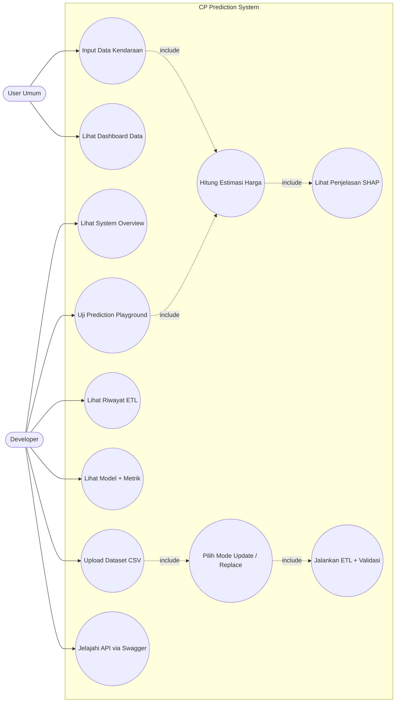

Di luar scope CP: benchmarking multi-model (RF/LightGBM), LIME, auto-retraining
MLOps, deteksi drift, rekomendasi MCDM, scraping real-time, auth kompleks,
auto-deploy model setelah training, code editor/eksekusi arbitrary code dari portal.

## Fase 2: Perancangan Sistem

### 2.1 Ringkasan Topologi Sistem

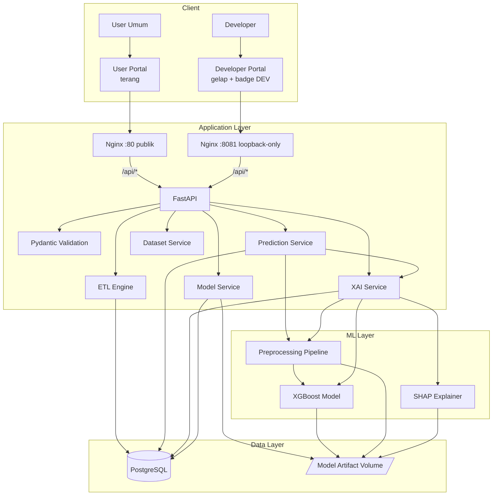

### 2.2 Dekomposisi Arsitektur Codebase (Layered Architecture)

Codebase dirancang dengan arsitektur berlapis (*layered architecture*) yang memisahkan *presentation*, *gateway/routing*, *domain service*, *machine learning engine*, dan *data access*. Seluruh komponen mengikuti prinsip *Single Responsibility* dan minim ketergantungan silang:

```text
+-----------------------------------------------------------------------------------+
| 1. PRESENTATION LAYER (frontend/)                                                 |
|    - Dual SPA Bundle: User Portal (index.html) & Developer Portal (developer.html) |
|    - Adaptive Shells: DesktopView, MobileView (useWindowSize <= 768px), DevShell   |
|    - UI Components: VehicleForm, PredictionCard, ShapWaterfall, DataDashboard      |
|    - State & Client Services: usePrediction hook, api.js, formatCurrency.js       |
+-----------------------------------------------------------------------------------+
                                         |  HTTP / REST
                                         v
+-----------------------------------------------------------------------------------+
| 2. INGRESS & REVERSE PROXY LAYER (infra/nginx/)                                   |
|    - Port 80 (Publik): Serves User SPA + Proxy /api/ -> FastAPI (Blokir dev 404)  |
|    - Port 8081 (127.0.0.1 Loopback): Serves Dev SPA + Swagger /docs + Proxy /api/ |
+-----------------------------------------------------------------------------------+
                                         |  Reverse Proxy :8000
                                         v
+-----------------------------------------------------------------------------------+
| 3. API & WEB GATEWAY LAYER (backend/app/api/, backend/app/schemas/)              |
|    - App Lifespan: ModelManager warming + DB table init + auto-seed metadata      |
|    - Route Handlers: routes_health, routes_prediction, routes_model,              |
|                      routes_dataset, routes_etl, routes_developer, routes_stats   |
|    - Contract Validation: Pydantic schemas (PredictionRequest/Response, Stats)    |
+-----------------------------------------------------------------------------------+
                                         |  Invocations
                                         v
+-----------------------------------------------------------------------------------+
| 4. DOMAIN & SERVICE LAYER (backend/app/services/)                                 |
|    - ModelManager: Singleton in-memory loader untuk XGBoost artifact & preprocessor|
|    - PredictionService: Pipeline orkestrator (Input -> Preprocess -> Predict -> XAI)|
|    - ETLService: Streaming chunk parser CSV, data validator, batch DB ingestion   |
|    - StatsService: Agregasi analitik data listing mobil bekas untuk dashboard     |
+-----------------------------------------------------------------------------------+
                         |                                   |
                         v                                   v
+--------------------------------------+  +-----------------------------------------+
| 5. ML & EXPLAINABILITY (backend/ml/) |  | 6. REPOSITORY & PERSISTENCE (backend/db/|
|    - CategoricalPreprocessor         |  |    backend/app/repositories/)           |
|      (pandas.Categorical native)     |  |    - ListingRepository: bulk query/stats|
|    - Native XGBoost Booster Runtime  |  |    - ModelRepository: versions & metrics|
|    - In-Engine Tree SHAP Explainer   |  |    - PredictionRepository: JSONB audit  |
|      (pred_contribs=True, no SHAP lib|  |    - SQLAlchemy ORM 2.0 Engine          |
|       required at inference runtime) |  |    - PostgreSQL 16 (6 relational tables)|
+--------------------------------------+  +-----------------------------------------+
```

#### 1. Lapisan Frontend (`frontend/`)
- **Dual-SPA Multi-Page Architecture**: Dikonfigurasi melalui `vite.config.js` dengan dua entry point terisolasi: `index.html` (`src/main.jsx`) untuk User Portal dan `developer.html` (`src/developer/main.jsx`) untuk Developer Portal. Kode modul developer di-*chunk* terpisah (`developer-*.js`) sehingga tidak pernah bocor ke dalam bundle publik.
- **Adaptive Shell Switcher**: Hook `useWindowSize` mendeteksi *viewport width* secara reaktif (breakpoint 768px). Pada layar lebar (desktop), antarmuka menggunakan `DesktopView` dengan sidebar tetap. Pada layar kecil (mobile), antarmuka beralih ke `MobileView` dengan hamburger navigation dan *bottom navigation bar*.
- **Reusable Presentation Components**: Komponen visual utama (`VehicleForm`, `PredictionCard`, `ShapWaterfall`, `ShapBarChart`, `LoadingState`) digunakan secara konsisten baik pada User Portal maupun pada Developer Playground (`DevPlayground.jsx`).
- **Data Dashboard Visualizations**: `DataDashboard.jsx` menyajikan distribusi metrik mobil bekas (ringkasan, histogram harga, proporsi transmisi, perbandingan merek dan wilayah, serta histogram tahun) menggunakan visualisasi SVG native tanpa ketergantungan library grafik eksternal.
- **Client Service & State Management**: Modul `services/api.js` membungkus fetch API dengan penanganan timeout, `hooks/usePrediction.js` mengelola state siklus inferensi (idle, loading, success, error), dan `utils/formatCurrency.js` memformat representasi mata uang Rupiah.

#### 2. Lapisan Ingress & Reverse Proxy (`infra/nginx/`)
- **Port 80 (Public Gateway)**: Menyajikan static files User Portal (`index.html`), mem-proxy request rute `/api/` ke container backend (`fastapi:8000`), dan secara eksplisit memblokir request ke `developer.html` atau `/assets/developer*` dengan status HTTP 404.
- **Port 8081 (Loopback Developer Gateway)**: Dibatasi secara ketat hanya pada interface loopback `127.0.0.1`. Menyajikan Developer Portal (`developer.html`), dokumentasi Swagger UI (`/docs`, `/openapi.json`), dan mem-proxy `/api/`. Request ke `index.html` publik diblokir dengan status HTTP 404.

#### 3. Lapisan API & Web Gateway (`backend/app/api/`, `backend/app/schemas/`)
- **Lifespan Lifecycle Controller (`backend/app/main.py`)**: Mengelola inisialisasi aplikasi secara tersentralisasi saat proses startup: memastikan tabel PostgreSQL terbuat via SQLAlchemy, memuat model ML aktif ke memory lewat `ModelManager`, dan mengeksekusi auto-seed metadata dataset/model/listing (bila diaktifkan via `SEED_ON_STARTUP`).
- **Modular Route Handlers**:
  - `routes_health.py`: Healthcheck endpoint (`GET /health`) yang memverifikasi kesiapan model aktif.
  - `routes_prediction.py`: Endpoint inferensi tunggal (`POST /predictions`) dan pembacaan detail riwayat prediksi (`GET /predictions/{id}`).
  - `routes_model.py`: Endpoint informasi model aktif (`GET /models/active`) dan katalog seluruh versi model (`GET /models`).
  - `routes_dataset.py`: Multipart upload streaming dataset CSV (`POST /datasets/upload`) serta metadata dataset (`GET /datasets`, `GET /datasets/{id}`).
  - `routes_etl.py`: Riwayat audit eksekusi ETL (`GET /etl/jobs`).
  - `routes_developer.py`: Agregasi ringkasan diagnostik backend, database, model, dan status ETL (`GET /developer/overview`).
  - `routes_stats.py`: Endpoint metrik statistik agregat listing mobil bekas (`GET /stats/dataset`).
- **Schema Contracts (`backend/app/schemas/`)**: Pydantic models mendefinisikan validasi batas ketat (`1930 <= year <= 2026`, `km >= 0`, `price >= 0`) dan serialisasi JSON terstruktur.

#### 4. Lapisan Domain & Service (`backend/app/services/`)
- **`ModelManager` (`model_manager.py`)**: Singleton in-memory cache untuk artefak model XGBoost. Membaca file `model.json`, `preprocessing.joblib`, dan skema fitur sekali saat startup. Tidak melakukan disk I/O ulang saat melayani request inferensi.
- **`PredictionService` (`prediction_service.py`)**: Mengorkestrasi alur inferensi: memvalidasi fallback kilometer (`km_1` atau `km_2`), mentransformasi input ke format DataFrame berkategori native, memanggil XGBoost Booster untuk memprediksi harga, mengekstrak penjelasan pohon native, memetakan kembali kontribusi ke 6 fitur semantik, dan menyimpan log prediksi ke database secara best-effort tanpa menghambat respons pengguna.
- **`ETLService` (`etl_service.py`)**: Mengimplementasikan pemrosesan streaming batch untuk file CSV multipart tanpa memuat seluruh file ke RAM. Melakukan validasi header wajib, sanitasi batas numerik/kategorikal, pemfilteran listing `Bekas`/`Used`, serta mendukung mode ingestion `update` (append) dan `replace` (pengosongan data lama dataset lalu pengisian baru).
- **`StatsService` (`stats_service.py`)**: Menghitung analitik teragregasi langsung dari tabel listing database (total unit, mean/median/min/max harga, distribusi transmisi, ranking merek, dan sebaran tahunan).

#### 5. Lapisan Machine Learning & XAI (`backend/app/ml/`, `artifacts/models/`)
- **`CategoricalPreprocessor` (`categorical_preprocessor.py`)**: Mempertahankan tipe data kategori asli pandas (`pandas.Categorical`) untuk fitur berkardinalitas tinggi seperti `brand_type` (> 2.000 kategori). Menghindari ledakan dimensi One-Hot Encoding dan distorsi ordinal encoding. Menangani kategori baru saat inferensi dengan memetakannya ke *missing category* yang didukung langsung oleh algoritma pohon XGBoost.
- **Native In-Engine Tree SHAP**: Penjelasan fitur dihitung langsung di backend menggunakan fitur native pohon XGBoost `Booster.predict(..., pred_contribs=True)`. Menghasilkan *base value* dan nilai kontribusi per fitur secara aditif ($\text{Base Value} + \sum \phi_i = \text{Prediksi}$). Kecepatan komputasi berada pada orde milidetik dan tidak membutuhkan library `shap` pada saat runtime inferensi.
- **Versioned Artifact Bundle**: Disimpan per versi pada direktori `artifacts/models/xgboost/<version>/` yang mencakup 6 file lengkap: `model.json` (bobot model), `preprocessing.joblib` (state preprocessor), `feature_schema.json` (definisi fitur dan tipe data), `metrics.json` (skor MAE/RMSE/MAPE/R2 per split), `training_config.json` (parameter training dan random seed), serta `shap_config.json` (konfigurasi atribut explainability).

#### 6. Lapisan Repository & Persistensi Data (`backend/app/repositories/`, `backend/app/db/`)
- **Repository Pattern**: Mengisolasi logika query basis data dari lapisan route dan service:
  - `ListingRepository`: Pengambilan data listing teragregasi, query berfilter, dan operasi *bulk insert* batch.
  - `ModelRepository`: Pengambilan metadata versi model aktif dan metrik evaluasi per split.
  - `PredictionRepository`: Penyimpanan log inferensi dan riwayat prediksi dengan field `input_payload` dan `shap_payload` berbasis JSONB untuk kemudahan audit trail.
- **Database Engine & ORM**: Berbasis SQLAlchemy 2.0 dengan driver `psycopg` (PostgreSQL 16) menggunakan connection pooling dan session lifecycle `get_db()`.
- **Relational ERD Tables**: Terdiri dari 6 tabel: `datasets`, `etl_jobs`, `listings`, `model_versions`, `model_metrics`, dan `predictions`.

#### 7. Pipeline ML Offline & Reproducibility (`ml/scripts/`)
- **`profile_dataset.py`**: Skrip CLI untuk memprofiling dataset mentah `dataset.csv`, menganalisis korelasi redundansi `KM_1` dan `KM_2`, memfilter baris listing `Bekas` dan `Used` (21.553 baris), dan mengekspor dataset bersih ke `data/processed/`.
- **`train_baseline.py`**: Skrip pelatihan reproducible mandiri dengan random seed 42, pembagian 80/20 train/test, pelatihan XGBoost native categorical, evaluasi metrik performa, dan pembuatan paket artefak terversi.
- **`seed_db.py`**: Skrip populasi database independen untuk menginisialisasi metadata model, metrik evaluasi, dan listing data awal ke PostgreSQL.

### 2.3 Alur Eksekusi (Execution Flows)

Alur prediksi + penjelasan:

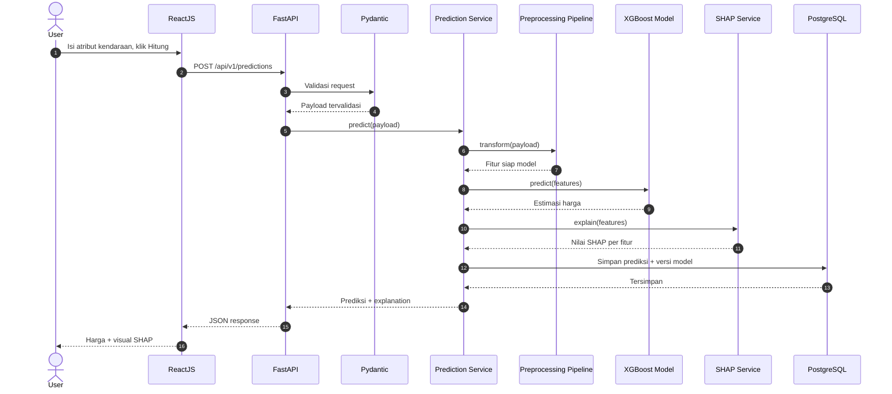

Alur upload dataset + ETL (Developer Portal):

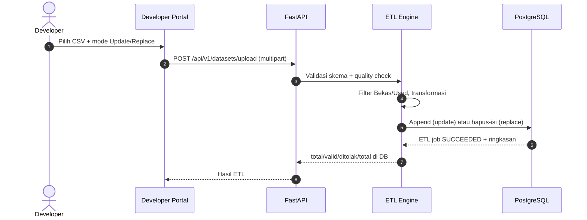

### 2.4 Topologi Deployment & Isolasi Jaringan

Deploy (sesuai `docker-compose.yml`):

```text
User biasa (jaringan)
  |
  v
http://<host>              (nginx :80, publik)
  |-- /        -> User Portal (frontend :80, index.html)
  |-- /api/    -> backend (FastAPI + Uvicorn :8000)
  (developer.html + chunk /assets/developer* diblokir 404 di port ini)

Developer (localhost / SSH tunnel)
  |
  v
http://localhost:8081      (nginx :8081, bind 127.0.0.1 saja)
  |-- /            -> Developer Portal (frontend :8081, developer.html)
  |-- /api/        -> backend (FastAPI :8000)
  |-- /docs        -> Swagger UI
  |-- /openapi.json -> OpenAPI contract

backend -> postgres :5432 (tidak diekspos ke host; volume postgres_data)
backend -> artifact model (bind-mount read-only)
pgAdmin langsung di :5050 (tanpa login, mode passwordless)
```

| Service  | Image / Build        | Akses host                        | Peran                                   |
|----------|----------------------|-----------------------------------|-----------------------------------------|
| nginx    | `nginx:alpine`       | `:80` publik, `:8081` loopback    | Reverse proxy dua port                  |
| frontend | build `./frontend`   | via nginx (`:80`/`:8081` internal)| Dua entry: `index.html` + `developer.html` |
| backend  | build `./backend`    | via nginx                         | FastAPI + XGBoost + SHAP + ETL          |
| postgres | `postgres:16-alpine` | -                                 | Database + metadata + log               |
| pgadmin  | `dpage/pgadmin4:9`   | `:5050`                           | Administrasi database                   |

## Fase 3: Persiapan Data dan Machine Learning

### Dataset dan keputusan data

`dataset.csv`: 22.679 baris, 14 kolom, target `price`, tanpa missing value.

| Jenis kolom | Kolom |
|---|---|
| Kategorikal | `brand` (51), `brand_type` (2.002), `machine_type`, `location` (22), `listing__type` |
| Numerik | `year` (1975-2025), `KM_1`, `KM_2` |
| Teks mentah | `item`, `ellipsize`, `listing__excerpt` |

Keputusan penelitian (diimplementasikan di `ml/scripts/` dan dipakai ulang oleh
ETL backend):

- Eksperimen utama hanya listing `Bekas` + `Used` (21.553 baris). `Baru` dibuang.
- `Unnamed: 0` = index, bukan fitur.
- `KM_1` dan `KM_2` berkorelasi 0,999 (redundan), dipakai satu: `km_1`.
- Kolom teks mentah tidak dipakai di baseline (scope + cegah leakage).
- `brand_type` high-cardinality dipertahankan sebagai dtype kategori dan diproses oleh
  native categorical XGBoost (`enable_categorical=true`), tanpa One-Hot Encoding,
  Ordinal Encoding, atau target leakage.

Dataset baru masuk **hanya** lewat upload Developer Portal + ETL (validasi skema,
quality check, filter `Bekas`/`Used`), dengan dua mode: **Update** (append, data
lama tetap ada) atau **Replace** (hapus semua data lama, isi data baru).
Batas upload via env `MAX_UPLOAD_MB` (default 50).

### Pipeline ML dan artifact model

```text
Raw CSV -> Filter Used/Bekas -> Quality Check -> Split 80/20 (seed 42)
  -> CategoricalPreprocessor -> XGBoost (enable_categorical=true)
  -> Evaluasi -> Artifact
```

Fitur: `year` dan `km_1` numerik; `brand`, `machine_type`, `location`, dan
`brand_type` dipertahankan sebagai `pandas.Categorical`. Kategori baru saat
inference dipetakan menjadi missing category dan tetap dapat diprediksi oleh
XGBoost native categorical.

Model aktif `xgb-v1` (`artifacts/models/xgboost/xgb-v1/`), metrik test:

| MAE | RMSE | MAPE | R2 |
|---|---|---|---|
| 25.446.042 | 52.997.228 | 8,40% | 0,9371 |

Konvensi artifact per versi (`model.json`, `preprocessing.joblib`,
`feature_schema.json`, `metrics.json`, `training_config.json`, `shap_config.json`):
satu `model_version` mengikat model + preprocessing + skema + metrik + konfigurasi
SHAP, sehingga inference selalu reproducible. Training bersifat offline/manual:

```bash
python ml/scripts/profile_dataset.py   # profiling + filter -> data/processed/
python ml/scripts/train_baseline.py    # latih + evaluasi + simpan artifact
```

Penjelasan lokal memakai kontribusi pohon native XGBoost
(`Booster.predict(pred_contribs=True)`), diagregasi kembali ke 6 fitur asli.
Terverifikasi aditivitasnya: `base_value + sum(shap) = prediksi` (residu Rp88
akibat pembulatan float32). Tidak butuh lib `shap` saat inference.

## Fase 4: Implementasi Sistem

### Backend (FastAPI)

Base URL `/api/v1`. Model dan preprocessing dimuat **sekali** saat startup
(lifespan), tidak reload per request. Inference dibatasi timeout (`INFERENCE_TIMEOUT_S`,
respons 504 bila lewat). Startup otomatis membuat tabel dan seed metadata
dataset + versi model + metrik. Kode:
`backend/app/{api,core,db,ml,repositories,schemas,services}`.

| Method | Endpoint | Keterangan |
|---|---|---|
| GET | `/health` | `{"status": "ok", "model_version": "xgb-v1"}` (503 bila model belum termuat) |
| POST | `/predictions` | Prediksi + explanation, log ke PostgreSQL (best-effort) |
| GET | `/predictions/{id}` | Detail input + prediksi + explanation |
| GET | `/models/active` | Metadata model aktif + metrik per split |
| GET | `/models` | Daftar seluruh versi model + metrik (Model Management) |
| POST | `/datasets/upload` | Upload CSV multipart (`file` + `mode` update/replace), langsung ETL |
| GET | `/datasets` | Daftar dataset + 5 ETL job terakhir per dataset |
| GET | `/datasets/{id}` | Detail dataset + 20 riwayat ETL |
| GET | `/etl/jobs` | Riwayat ETL job (`?limit`, default 20) |
| GET | `/developer/overview` | Agregat backend + database + dataset/model aktif + ETL readiness |
| GET | `/stats/dataset` | Statistik database listings (total, harga, tahun, km, merek, lokasi, histogram; filter opsional `brand`, `location`, `machine_type`, `year_min`, `year_max`) |

Contoh request prediksi:

```json
{"brand": "Honda", "brand_type": "City 1.5 E Sedan", "machine_type": "Automatic",
 "location": "DKI Jakarta", "year": 2021, "km_1": 45000, "km_2": 45000}
```

Contoh response:

```json
{"prediction_id": "uuid", "model_version": "xgb-v1", "predicted_price": 258148416,
 "currency": "IDR",
 "explanation": {"base_value": 313370208,
   "features": [{"feature": "year", "value": 2021, "shap_value": 25150464}] } }
```

Validasi Pydantic: `1930 <= year <= 2026`, `0 <= km <= 1.000.000` (batas dari
distribusi data, dapat diubah via env `MIN_YEAR`/`MAX_YEAR`/`MAX_KM`), minimal
satu dari `km_1`/`km_2` terisi, kategori asing ditoleransi (tetap memprediksi).
Training tidak diekspos sebagai endpoint (offline via `ml/scripts/`, tanpa
auto-retraining dan tanpa auto-deploy).

### Developer Portal

Konsol teknis di `http://localhost:8081` (loopback-only), entry `developer.html`,
shell gelap + badge DEV, 6 modul dengan navigasi sendiri:

| Modul | Rute | Fungsi |
|---|---|---|
| Business/System Overview | `#/developer` | Status backend, database, dataset/model aktif, ETL readiness |
| Dataset Management | `#/developer/datasets` | Upload CSV + pilihan **Update** (tambah) / **Replace** (ganti semua + warning), daftar dataset |
| ETL Management | `#/developer/etl` | Tabel riwayat job: file, mode, status, total/valid/ditolak |
| Model Management | `#/developer/models` | Versi model, badge ACTIVE, metrik MAE/RMSE/MAPE/R2 per split |
| Prediction Playground | `#/developer/playground` | Uji prediksi + SHAP memakai komponen yang sama dengan User Portal |
| API Explorer | `#/developer/api` | Katalog endpoint + tombol ke Swagger UI (`/docs`, same-origin) |

Isolasi dari user biasa berlapis: port berbeda + bind loopback, entry build
terpisah (bundle user terbukti bersih dari kode developer), nginx memblokir
silang (`developer.html` 404 di port 80, `index.html` 404 di port 8081), tanpa
link dari User Portal ke Developer Portal, dan `noindex, nofollow`.

### User Portal (ReactJS)

Halaman `Beranda` (penjelasan + metrik model live dari API), `Data` (dashboard
statistik database listings: tata letak lebar di desktop dan ringkas di mobile,
ringkasan, histogram harga, perbandingan transmisi, merek dan lokasi berdampingan,
histogram tahun penuh, semuanya dengan tooltip hover/sentuh/fokus dan
scroll-reveal), dan `Hitung estimasi`
(formulir -> kartu hasil -> grafik SHAP). Komponen: `VehicleForm`,
`PredictionCard`, `ShapWaterfall`, `ShapBarChart`, `LoadingState`, plus
`services/api.js`, `hooks/usePrediction.js`, `utils/formatCurrency.js`.

Aturan yang dipegang: styling Tailwind CSS, satu aplikasi dua shell via hook
`useWindowSize` (batas 768px): desktop dengan Sidebar statis, mobile dengan
Hamburger Menu + Bottom Navigation Bar, tanpa emoji (ikon SVG inline), hasil
disebut **estimasi model** bukan harga pasti, opsi dropdown dari dataset asli
(47 merek, 21 lokasi), semua angka dari API, state kosong/loading/error
informatif (sebab + aksi), responsif dan keyboard-only friendly (skip link,
kontrol native, fokus terlihat). API base via `VITE_API_URL`, default
same-origin `/api/v1`. Bundle user tidak memuat rute/navigasi developer.

### Database (PostgreSQL + pgAdmin)

Enam tabel sesuai ERD: `datasets` (metadata + status + counter valid/ditolak),
`etl_jobs` (riwayat eksekusi ETL: mode, file, total/valid/ditolak, status),
`listings` (observasi mobil bekas), `model_versions` (mini model registry, satu
baris aktif), `model_metrics` (metrik per split: test/validation), `predictions`
(`input_payload` + `shap_payload` sebagai JSONB untuk audit trail).

Seed metadata otomatis saat backend start. Tabel `listings` ikut di-seed otomatis
bila kosong dan file CSV tersedia (`SEED_CSV_PATH`, di compose ter-mount dari
`./data/processed`; bila belum ada, fallback ke `SEED_FALLBACK_CSV_PATH` =
`dataset.csv` mentah yang ikut ter-mount di `/app/dataset.csv`). Matikan dengan `SEED_ON_STARTUP=false`. Seed manual
penuh (dataset + listings + model + metrik):

```bash
# Postgres harus dapat dijangkau, mis. port-forward atau DATABASE_URL lokal
set DATABASE_URL=postgresql+psycopg://app@HOST:5432/carprice
python ml/scripts/seed_db.py
```

pgAdmin tanpa login di `http://localhost:5050`, server `carprice (local)` sudah
terdaftar otomatis.

### Struktur repo

```text
frontend/                  # ReactJS, dua entry: index.html (user) + developer.html
  src/
    layouts/               # DesktopView/MobileView (user) + DeveloperShell
    developer/             # devNav.js + main.jsx (entry developer)
    components/            # prediction (dipakai ulang playground), nav, shell user
    pages/                 # Home/Prediction/DataDashboard + developer/ (6 modul)
    services/hooks/utils/  # api.js, usePrediction.js, formatCurrency.js
  nginx.conf               # dua server: :80 user, :8081 developer (+ blokir silang)
backend/                   # FastAPI (app/api, core, db, repositories, schemas, services)
  app/api/                 # routes_health/prediction/model/dataset/etl/developer/stats
  app/services/            # prediction_service, model_manager, stats_service, etl_service
testing/                   # 5 skrip pengujian flat (run_all.py + 1..5, tanpa subdirektori)
  run_all.py               # master orchestrator
  1_data_validation.py     # Suite 1
  2_unit_testing.py        # Suite 2
  3_integration_testing.py # Suite 3
  4_functional_testing.py  # Suite 4
  5_model_xai_validation.py # Suite 5
ml/scripts/                # profile_dataset, train_baseline, seed_db
data/processed/            # hasil filter (regenerable, di-ignore git)
artifacts/models/          # artifact versioned xgb-v1
infra/nginx/               # reverse proxy dua port (80 publik + 8081 loopback)
infra/pgadmin/             # servers.json praregistrasi
docs/figures/              # aset gambar laporan: bab4/*.png (diagram) + views/**/*.jpeg
docker-compose.yml
.env.example
```

## Fase 5: Integrasi dan Pengujian

Sumber kebenaran dokumentasi pengujian adalah bagian ini. Tidak ada `README.md`
terpisah di dalam `testing/` — seluruh panduan suite terpusat di sini.

```text
testing/
├── run_all.py                  # Master test orchestrator (menjalankan kelima suite)
├── 1_data_validation.py        # Suite 1: Data Validation & ETL Rules
├── 2_unit_testing.py           # Suite 2: Unit Testing, Static Analysis, & Utility
├── 3_integration_testing.py   # Suite 3: Integration Testing & Security Boundary
├── 4_functional_testing.py    # Suite 4: Functional Testing & Frontend Quality Gate
└── 5_model_xai_validation.py  # Suite 5: Model Artifacts & Tree SHAP Validation
```

### Suite 1: Data Validation (`testing/1_data_validation.py`)
- Memvalidasi dataset mentah `dataset.csv`: 22.679 baris, 14 kolom, 0 missing value, 21.553 listing Bekas/Used (1.126 listing Baru dibuang).
- Memverifikasi korelasi `KM_1` dan `KM_2` (~0.999 redundansi).
- Menguji aturan penolakan data ETL (`REQUIRED` headers, tahun di luar batas, KM negatif/ekstrem, harga negatif, kategori kosong/whitespace).

### Suite 2: Unit Testing (`testing/2_unit_testing.py`)
- Menjalankan 17 unit test backend Pytest dalam container (SQLite in-memory): healthcheck, validasi request Pydantic, transformasi kategorikal, endpoint predictions roundtrip, dataset detail, stats aggregations.
- Menjalankan kompilasi statis `compileall` dan verifikasi `git diff --check`.
- Menguji fungsionalitas pemformatan mata uang Rupiah pada `frontend/src/utils/formatCurrency.js`.

### Suite 3: Integration Testing (`testing/3_integration_testing.py`)
- Menguji integrasi end-to-end REST API live di port 80 dan 8081 (`GET /health`, `POST /predictions`, `GET /predictions/{id}`, `GET /models/active`, `GET /developer/overview`, `GET /stats/dataset`).
- Menguji penanganan error dan upload multipart CSV (`mode=update` append, penolakan mode invalid 400, header rusak 400, CSV tanpa listing Bekas 400).
- Memverifikasi isolasi keamanan Nginx dua port: Port 80 publik memblokir aset developer (HTTP 404), Port 8081 loopback memblokir index publik (HTTP 404) dan membuka Swagger UI (`/docs`).

### Suite 4: Functional Testing (`testing/4_functional_testing.py`)
- Memverifikasi proses build produksi Vite multi-page (`npm run build`) yang menghasilkan dua bundle terpisah: `index.html` (User Portal) dan `developer.html` (Developer Portal).
- Memastikan tidak ada bundle chunk developer yang bocor ke dalam bundle publik.
- Mengaudit seluruh source code frontend (`frontend/src/`) untuk menjamin 0 karakter emoji dan ketiadaan endpoint hardcoded.
- Memvalidasi matriks use-case fungsional sistem (UC1 s.d. UC12).

### Suite 5: Model & XAI Validation (`testing/5_model_xai_validation.py`)
- Memverifikasi integritas kontrak 6 file artifact pada `artifacts/models/xgboost/xgb-v1/`.
- Menguji reproduksibilitas pelatihan ulang model dengan random seed 42 ke direktori sementara tanpa menimpa model produksi (R2 >= 0.93, MAPE <= 9%).
- Menguji kebenaran native Tree SHAP pada 5 skenario input (tipikal, kilometer ekstrem, tahun tua 1975, kategori asing, fallback kilometer).
- Memastikan jaminan additivitas Tree SHAP: `|Base Value + sum(phi) - Prediksi| <= Rp1.000` dan latensi inferensi di bawah 10 detik.

### Metode eksekusi (urutan wajib `0 -> 1 -> 2 -> 3 -> 4 -> 5`)

Pre-task: `git log -n 10 --oneline`, `git status --short`, `git diff --check`; baca `AGENTS.md`, `README.md`, `.env.example`, header `dataset.csv`. Petakan stack `backend/app/{api,core,db,ml,repositories,schemas,services}`, `ml/scripts/`, `frontend/src/`, `artifacts/models/xgboost/xgb-v1/`, `testing/`. Jangan `git commit` tanpa approval; jangan timpa `artifacts/.../xgb-v1/` (retrain uji pakai `ARTIFACT_ROOT` temp); env kunci `MIN_YEAR=1930,MAX_YEAR=2026,MAX_KM=1000000,INFERENCE_TIMEOUT_S=10,RANDOM_SEED=42`.

- **Suite 1 — Data Validation**: `python ml/scripts/profile_dataset.py` harus menghasilkan `rows=22679`, 14 kolom, `missing=0`, `Bekas+Used=21553` (`Baru=1126` dibuang), korelasi `KM_1-KM_2 ~0.999` (pakai `km_1`), `brand~51, brand_type~2002, location~22`, `year 1975-2025`. Quality check independen: duplikat=0, `price<=0`=0, year/km di luar batas=0, kolom teks mentah tidak jadi fitur. Aturan ETL (`etl_service.py:11-55`): tolak header hilang, `listing__type=Baru`, year/km/price invalid, kategori kosong, mode selain update/replace.
- **Suite 2 — Unit Testing**: `cd backend && python -m pytest tests -q` (SQLite isolasi via `conftest.py`) — baseline `17 passed`. Cakupan: `CategoricalPreprocessor` (kategori asing -> `pd.NA`), `ModelManager.predict_row` (6 fitur, sort `abs(shap)`), `PredictionService` (fallback `km_1 ?? km_2`, `price=max(0,round)`, log best-effort), skema Pydantic (`year`/`km` invalid -> 422, `km_1=km_2=None` -> 422, `extra=forbid`), `normalize_mode`/`_parse_row`, repository roundtrip, `formatCurrency.js`. Verifikasi statis `compileall` + `git diff --check` bersih.
- **Suite 3 — Integration Testing**: payload kanonis `{"brand":"Honda","brand_type":"City 1.5 E Sedan","machine_type":"Automatic","location":"DKI Jakarta","year":2021,"km_1":45000,"km_2":45000}`. `GET /health` -> 200 (`xgb-v1`) / 503 bila model belum load; `POST /predictions` -> 200 (6 fitur, `currency=IDR`); `GET /predictions/{id}` roundtrip; `GET /models/active` ada `metrics.test`; ETL `update` -> `append valid_rows=2`, `replace` -> `replaced=true`; header/mode/tipe salah dan semua-`Baru` -> 400; kategori asing -> 200, tipe/numerik salah -> 422. Docker E2E: `compose config/up/ps`, curl health/predict/overview, postgres privat, artifact read-only, `model_version` tertelusur ke baris `predictions`. Nginx: `:80` 404 untuk `developer.html`, `:8081` 404 untuk `index.html` + buka `/docs`.
- **Suite 4 — Functional Testing**: `npm run build` dua entry terisolasi (`developer-*.js` tidak bocor ke bundle publik), audit 0 emoji + tanpa hardcode di `frontend/src/`, matriks UC1-UC12 (User: input-estimasi-SHAP-dashboard; Developer: overview-datasets-ETL-models-playground-API explorer), state kosong/loading/error informatif, responsif 768px, keyboard-friendly, kontras WCAG AA.
- **Suite 5 — Model & XAI Validation**: kontrak 6 file artifact; baseline `MAE=25446042, RMSE=52997228.34, MAPE=8.397%, R2=0.9371, n_test=4311`. Retrain uji seed 42 ke dir temp: gate `R2>=0.93, MAPE<=9%`, toleransi ±10%. XAI via `predict_row` pada 5 skenario (tipikal, km ekstrem, tahun 1975, kategori asing, fallback km): 6 fitur, `base>0`, `price>=0`, additivitas `|base+sum(shap)-price|<=Rp1.000`, deterministik, latensi < `INFERENCE_TIMEOUT_S`. SHAP global opsional (`TreeExplainer` 200 baris -> shape `(200,6)`; skip di Python 3.13 = skipped bukan fail).

### Cara menjalankan

Prasyarat: Docker Compose aktif (`docker compose up -d`), Python 3.11+, Node.js.

```bash
python testing/run_all.py
# atau per suite:
python testing/1_data_validation.py
python testing/2_unit_testing.py
python testing/3_integration_testing.py
python testing/4_functional_testing.py
python testing/5_model_xai_validation.py
```

### Hasil eksekusi resmi (13 Okt 2026, commit `e96a380`) — verdict GO

| Kategori | Status | Bukti kunci |
|---|:---:|---|
| 0. Pre-task | PASS | working tree bersih, kontrak tervalidasi |
| 1. Data Validation | PASS | 22679 baris, 21553 Bekas/Used, 0 null/duplikat, 8 kasus ETL lolos, korelasi 0.998979 |
| 2. Unit Testing | PASS | `17 passed` (1.29s), `compileall` bersih, `formatIDR(150jt)=Rp 150.000.000` |
| 3. Integration | PASS | health/predict/models/ETL/stats 200, `bad_mode/bad_header/all_baru` 400, isolasi `p80 dev:404, p8081 docs:200/idx:404` |
| 4. Functional | PASS | build 1.37s, chunk developer 16.5 KB terpisah, 0 emoji, UC1-UC12 valid |
| 5. Model & XAI | PASS | 6 file utuh, retrain `R2=0.9364, MAPE=8.19%`, residu <= Rp116, latensi <= 14.5 ms |
| TOTAL | PASS | 0 FAIL, 0 SKIPPED |

Matriks XAI (`base=313.736.320` semua kasus): Tipikal Honda 2021 Rp215.566.928 residu Rp70,25 (14.52 ms); KM ekstrem Avanza 2015 Rp158.925.200 residu Rp116,00 (5.58 ms); Tahun tua Corolla 1975 Rp85.211.360 residu Rp5,50 (6.69 ms); Kategori asing Rp688.307.712 residu Rp33,00 (8.26 ms); Fallback KM Xenia 2018 Rp125.330.320 residu Rp52,50 (5.29 ms). Residu berasal dari presisi float32, di bawah toleransi Rp1.000. `xgb-v1` tidak tertimpa (retrain di dir temp), `git diff --check` bersih, tanpa commit otomatis.

### Kriteria penerimaan

- [x] Dataset dimuat dan divalidasi (21.553 Bekas/Used, 0 missing).
- [x] Preprocessing reproducible (satu pipeline train = inference).
- [x] XGBoost terlatih sebagai artifact versioned (`xgb-v1`).
- [x] Prediksi di test set + MAE/RMSE/MAPE/R2 terhitung.
- [x] SHAP lokal per prediksi (aditivitas terverifikasi; global mengikuti dari artifact + metrik).
- [x] Endpoint prediksi + explanation berjalan.
- [x] Endpoint dataset/ETL berjalan (upload Update/Replace, validasi skema, filter Bekas/Used).
- [x] Endpoint model metadata berjalan (active + list + metrik).
- [x] Endpoint developer overview berjalan.
- [x] ReactJS User Portal kirim input, tampilkan harga + SHAP.
- [x] Developer Portal 6 modul (overview, datasets, ETL, models, playground, API explorer).
- [x] Developer Portal terisolasi di port loopback, bundle user bersih dari kode developer.
- [x] PostgreSQL simpan metadata dataset/model, riwayat ETL, + log prediksi.
- [x] `docker compose up` menjalankan semua service.
- [x] `model_version` tertelusur dari respons prediksi.

## Fase 6: Deployment

### Konfigurasi dan password

Semua endpoint, secret, dan parameter via environment (`.env`, contoh di
`.env.example`). Tidak ada hardcode port/URL/secret di source code.

**Mode default = passwordless lokal** (cukup `docker compose up`):

- Postgres: `POSTGRES_HOST_AUTH_METHOD=trust`, tanpa password.
- pgAdmin: desktop mode tanpa layar login, server terdaftar via `servers.json`.

Bila butuh password (server bersama/produksi):

1. Isi `POSTGRES_PASSWORD=...` dan `POSTGRES_HOST_AUTH_METHOD=scram-sha-256`.
2. Samakan di `DATABASE_URL=postgresql+psycopg://app:<password>@postgres:5432/carprice`.
3. Kembalikan pgAdmin ke mode login (hapus `PGADMIN_CONFIG_SERVER_MODE`) dan
   daftarkan server manual (host `postgres`, user `app`, password sama).

Variabel utama: `DATABASE_URL`, `POSTGRES_DB/USER/PASSWORD/HOST_AUTH_METHOD`,
`PGADMIN_PORT/DEFAULT_EMAIL`, `MODEL_DIR`, `MODEL_VERSION`,
`CORS_ORIGINS`, `INFERENCE_TIMEOUT_S`, `MAX_UPLOAD_MB`, `DEVELOPER_PORT`,
`RANDOM_SEED`, `DATASET_PATH`, `SEED_ON_STARTUP`, `SEED_CSV_PATH`,
`VITE_API_URL`, `VITE_API_TIMEOUT_MS`, `VITE_USER_PORTAL_URL`.

### Deploy dan menjalankan

Prasyarat: Docker + Docker Compose v2.

```bash
cp .env.example .env          # opsional, default sudah passwordless
docker compose up -d --build  # bangun + jalankan semua service
docker compose ps             # pastikan semua Up/healthy
```

Akses:

| Layanan | URL | Keterangan |
|---|---|---|
| User Portal | http://localhost/ | Publik |
| Hitung estimasi | http://localhost/#/prediksi | Publik |
| Developer Portal | http://localhost:8081/ | Loopback-only (developer) |
| Swagger UI | http://localhost:8081/docs | Via port developer |
| API health | http://localhost/api/v1/health | Publik |
| pgAdmin | http://localhost:5050 | Tanpa login |

Uji cepat end-to-end:

```bash
curl http://localhost/api/v1/health
curl -X POST http://localhost/api/v1/predictions -H "Content-Type: application/json" -d "{\"brand\":\"Honda\",\"brand_type\":\"City 1.5 E Sedan\",\"machine_type\":\"Automatic\",\"location\":\"DKI Jakarta\",\"year\":2021,\"km_1\":45000,\"km_2\":45000}"
curl http://localhost:8081/api/v1/developer/overview
```

Upload dataset via Developer Portal (contoh mode replace):

```bash
curl -X POST http://localhost:8081/api/v1/datasets/upload -F "mode=replace" -F "file=@dataset_baru.csv"
```

Perintah umum: `docker compose logs -f backend`, `docker compose down`,
`docker compose down -v` (hapus juga data postgres dan pgAdmin).

Troubleshooting:

- `backend` restart terus: cek `docker compose logs backend`; pastikan folder
  `artifacts/models/xgboost/xgb-v1/` ada (di-mount read-only).
- `pgadmin` meminta login: pastikan `PGADMIN_CONFIG_SERVER_MODE=False` dan volume
  `servers.json` termount; hapus volume `pgadmin_data` bila config lama tersimpan.
- `postgres` menolak koneksi: tunggu healthcheck (`pg_isready`), cek
  `POSTGRES_HOST_AUTH_METHOD`.
- Developer Portal tidak bisa diakses dari jaringan lain: memang disengaja
  (bind `127.0.0.1`); gunakan SSH tunnel ke server.
- Build backend lama (>10 menit): wajar, instalasi `xgboost` + `shap` (+ lib sains)
  di image `python:3.11-slim`. Package `shap` hanya dibutuhkan workflow
  training/profiling; inference memakai kontribusi native XGBoost.

Pengembangan lokal tanpa Docker: backend `pip install -r backend/requirements.txt`
lalu `uvicorn app.main:app` dari `backend/` (set `DATABASE_URL` sqlite/Postgres
dan `MODEL_DIR` absolut); frontend `npm install && npm run dev` dari `frontend/`
(proxy `/api` ke `localhost:8000`, kedua entry ter-serve oleh Vite dev server).

## Fase 7: Pemeliharaan dan Evaluasi

Evaluasi resmi 13 Okt 2026 (commit `e96a380`) memberi verdict **GO**: 6/6 kategori
pengujian PASS, 0 FAIL — lihat matriks hasil di Fase 5. Pemeliharaan bertumpu pada
artifact versioned per `model_version`, retraining offline/manual tanpa auto-deploy,
dan reproducibility seed 42.

### Keterbatasan

Keterbatasan CP: baseline satu model, lib `shap` tidak bisa build di Python 3.13
lokal (diverifikasi di image 3.11; inference memakai kontribusi native XGBoost), training
offline/manual tanpa endpoint, tanpa auth/drift-monitoring. Isolasi Developer
Portal mengandalkan bind loopback + split entry (tanpa login); auth penuh
ditunda ke TA.

---

# BAB III METODE PENGEMBANGAN

## 3.1 Tahapan Pengembangan

Pengembangan OtoValue dibagi menjadi tujuh fase berurutan. Kebutuhan sistem sudah
terdefinisi sejak awal, yaitu menghasilkan estimasi harga mobil bekas sekaligus
menjelaskan faktor yang mempengaruhinya, sehingga keluaran setiap fase menjadi
masukan fase berikutnya.

**Fase 1: Analisis Kebutuhan.** Memetakan prinsip estimasi harga dan penjelasan
SHAP, mengidentifikasi dua aktor (User Umum dan Developer), mendefinisikan 12
*use case* utama (UC1 sampai UC12), serta menetapkan batas ruang lingkup proyek.

**Fase 2: Perancangan Sistem.** Merancang arsitektur berlapis, skema basis data
relasional enam tabel (ERD), kontrak REST API `/api/v1`, dan topologi *reverse
proxy* Nginx dua port.

**Fase 3: Persiapan Data dan Machine Learning.** Memfilter dataset menjadi 21.553
baris listing `Bekas` dan `Used`, memproses empat fitur kategorikal dengan tipe
`pandas.Categorical`, melatih model XGBoost dengan `enable_categorical=true`, dan
mengekspor artefak terversi `xgb-v1`.

**Fase 4: Implementasi Sistem.** Membangun layanan backend FastAPI,
mengintegrasikan engine *Tree SHAP* native, dan menyusun dua portal ReactJS
terisolasi (User Portal dan Developer Portal).

**Fase 5: Integrasi dan Pengujian.** Mengeksekusi lima suite pengujian terpusat:
Data Validation, Unit Testing, Integration Testing, Functional Testing, dan
Model/XAI Validation.

**Fase 6: Deployment.** Mengontainerisasi seluruh layanan dengan Docker Compose,
memakai konfigurasi *passwordless* lokal dan isolasi *loopback* untuk Developer
Portal.

**Fase 7: Pemeliharaan dan Evaluasi.** Menjalankan pengujian penerimaan dengan
verdict GO/NO-GO dan mendokumentasikan keterbatasan sistem untuk pengembangan
lanjutan.

Alur berurutan tujuh fase tersebut digambarkan pada Gambar 3.1.

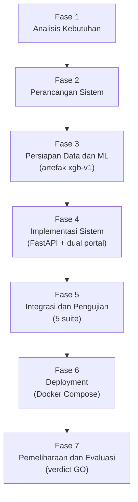

Gambar 3.1 Diagram alur tahapan pengembangan OtoValue

Setiap fase memakai metode dan algoritma yang berbeda. Pemetaannya ada pada
Tabel 3.1.

Tabel 3.1 Pemetaan fase, metode, dan algoritma

| Fase | Metode | Algoritma / Teknologi |
|---|---|---|
| 1 | Analisis kebutuhan aktor dan use case | Pemodelan use case (UC1-UC12) |
| 2 | Perancangan arsitektur dan basis data | Layered architecture, ERD 6 tabel, kontrak REST |
| 3 | Persiapan data dan pelatihan model | Filter Bekas/Used, `pandas.Categorical`, XGBoost native categorical (`enable_categorical=true`), split 80/20 seed 42 |
| 4 | Implementasi layanan dan antarmuka | FastAPI + Pydantic, Tree SHAP native (`predict(pred_contribs=True)`), ReactJS dua entry, repository pattern |
| 5 | Pengujian perangkat lunak | Pytest, pengujian integrasi REST, pengujian fungsional build, validasi XAI |
| 6 | Deployment | Docker Compose, Nginx reverse proxy dua port |
| 7 | Evaluasi penerimaan | Verdict GO/NO-GO berbasis matriks kriteria penerimaan |

## 3.2 Instrumen Penelitian

Penelitian ini memakai instrumen perangkat keras, perangkat lunak, serta aset
data yang dijelaskan berikut.

**Perangkat keras.** Komputer pengembangan dengan prosesor AMD Ryzen 7 5700X,
RAM 32 GB (2 x 16 GB), kartu grafis NVIDIA GeForce RTX 3050 6 GB, dan
penyimpanan SSD NVMe untuk menjalankan kontainer Docker serta pelatihan model.

**Perangkat lunak.** Bahasa Python 3.11+ untuk backend dan pipeline ML,
JavaScript/Node.js untuk frontend, FastAPI dan Uvicorn sebagai ASGI server,
ReactJS dengan Vite *multi-page build*, Tailwind CSS, XGBoost
(`enable_categorical=true`), pandas, NumPy, Joblib, Pytest, PostgreSQL 16,
SQLAlchemy 2.0 ORM, pgAdmin 4, Nginx Alpine, serta Docker Engine dan Docker
Compose v2.

**Dataset dan artefak.** Dataset transaksi mobil bekas `dataset.csv` dengan
22.679 baris mentah dan 21.553 baris terfilter, serta paket artefak terversi
`xgb-v1` yang terdiri dari enam file (`model.json`, `preprocessing.joblib`,
`feature_schema.json`, `metrics.json`, `training_config.json`,
`shap_config.json`).

Tabel 3.2 Instrumen penelitian

| Kategori | Instrumen |
|---|---|
| Hardware | AMD Ryzen 7 5700X, RAM 32 GB (2 x 16 GB), RTX 3050 6 GB, SSD NVMe |
| Bahasa | Python 3.11+, JavaScript/Node.js |
| Backend | FastAPI, Uvicorn, Pydantic |
| Frontend | ReactJS (Vite multi-page), Tailwind CSS |
| Machine Learning | XGBoost (native categorical), pandas, NumPy, Joblib, scikit-learn, Pytest |
| Basis data | PostgreSQL 16, SQLAlchemy 2.0, pgAdmin 4 |
| Infrastruktur | Nginx Alpine, Docker Engine, Docker Compose v2 |
| Data | `dataset.csv` (22.679 baris / 21.553 terfilter), artefak `xgb-v1` (6 file) |

---

# BAB IV GAMBARAN PENGEMBANGAN PRODUK

## 4.1 Gambaran Sistem

### 4.1.1 Gambaran Sistem Saat Ini

Pengembangan OtoValue berakar dari studi literatur mengenai dinamika pasar mobil
bekas, bukan pembaruan dari sistem perangkat lunak yang sudah ada sebelumnya.
Saat ini, penentuan harga kendaraan bekas masih sangat bertumpu pada penilaian
subjektif pemilik kendaraan maupun pihak *showroom* (Maulana et al., 2025).
Perbedaan dasar penilaian tersebut membuat kendaraan dengan spesifikasi setara
kerap ditawarkan pada harga yang jauh berbeda, sehingga memicu asimetri
informasi dan risiko kerugian dalam transaksi (Anggara et al., 2025; Robiul R et
al., 2025). Akibatnya, sebanyak 53,1% calon pembeli mengalami kesulitan dalam
memilih mobil bekas karena belum memiliki acuan harga yang jelas (Prayogi et
al., 2026).

Penaksiran nilai kendaraan semakin rumit karena depresiasi dipengaruhi oleh
banyak variabel nonlinier, seperti usia mobil, jarak tempuh, kapasitas mesin,
dan jenis transmisi (Hasibuan et al., 2022; Bergmann & Feuerriegel, 2025). Di
sisi lain, studi literatur menunjukkan bahwa penerapan model pembelajaran mesin
seperti XGBoost mampu memprediksi harga dengan baik, namun strukturnya yang
kompleks menyulitkan pengguna untuk menelusuri kontribusi tiap karakteristik
kendaraan tanpa bantuan metode Explainable AI seperti SHAP (Li, 2025). Selain
itu, belum tersedia sistem berbasis web yang mengintegrasikan model prediksi
bersama visualisasi penjelasan fitur tersebut ke dalam satu antarmuka yang
mudah digunakan (Hasibuan et al., 2022).

### 4.1.2 Target Produk Dikembangkan

Target produk adalah *proof-of-concept* end-to-end bernama OtoValue dengan dua
sasaran utama:

1. Memprediksi harga mobil bekas memakai model XGBoost Regressor dari enam fitur
   karakteristik kendaraan (`brand`, `brand_type`, `machine_type`, `year`,
   `km_1`, dan `location`).
2. Menjelaskan prediksi tersebut memakai Explainable Artificial Intelligence (XAI)
   berbasis Tree SHAP, baik penjelasan global maupun lokal, sehingga pengguna
   memahami arah serta bobot kontribusi tiap faktor pembentuk harga.

Pengembangan sistem memegang lima prinsip arsitektural inti:

- **Satu pipeline preprocessing**: Transformasi data yang sama diterapkan pada
  tahap pelatihan dan tahap inferensi untuk mencegah inkonsistensi serta kebocoran
  data (*data leakage*).
- **Pelacakan versi model (*model versioning*)**: Setiap hasil estimasi harga
  mencatat atribut `model_version`, sehingga luaran prediksi selalu dapat
  ditelusuri ke artefak bobot dan metrik evaluasi yang menghasilkannya.
- **Penjelasan SHAP terintegrasi langsung di backend**: Kontribusi fitur dihitung
  di dalam alur permintaan inferensi (`Input -> Prediction -> Explanation -> UI`)
  menggunakan kontribusi pohon native XGBoost, sehingga file model tidak perlu
  dikirim ke browser pengguna.
- **Arsitektur berbasis API (*API-first*)**: Lapisan antarmuka pengguna ReactJS
  hanya bertindak sebagai *presentation layer*, sedangkan seluruh logika inferensi
  dan manipulasi data dikelola secara tersentralisasi oleh FastAPI melalui pola
  *repository*.
- **Pemisahan antarmuka portal ganda**: Menyediakan User Portal untuk publik dan
  Developer Portal untuk pengelolaan teknis yang diisolasi khusus pada antarmuka
  jaringan *loopback*.

### 4.1.3 Gambaran Umum Produk Dikembangkan

OtoValue dioperasikan sebagai aplikasi web terintegrasi dengan dua portal
terpisah: User Portal pada port 80 untuk kebutuhan publik dan Developer Portal
pada port 8081 yang diikat (*bound*) khusus ke alamat *loopback* `127.0.0.1`.
Kedua portal berkomunikasi dengan backend FastAPI yang memuat model XGBoost ke
memori dan menghitung estimasi harga beserta penjelasan kontribusi fitur di dalam
satu alur permintaan HTTP. Gambaran umum arsitektur produk disajikan pada
Gambar 4.1.

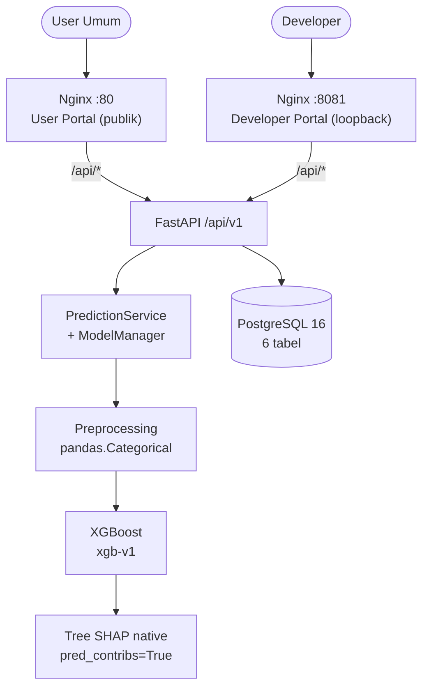

Gambar 4.1 Gambaran umum arsitektur produk OtoValue

## 4.2 Gambaran Sistem Dikembangkan

### 4.2.1 Fungsi Utama Produk

Sistem menyediakan 12 fungsi utama (UC1 sampai UC12) yang melayani dua aktor,
yaitu User Umum dan Developer. Pemetaan use case disajikan pada Gambar 4.2.

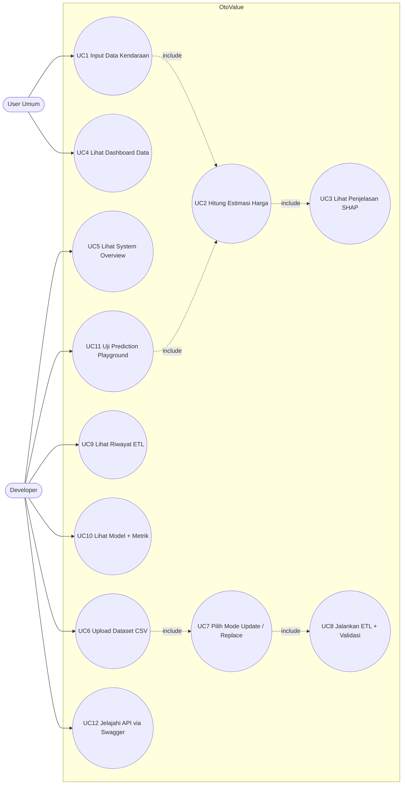

Gambar 4.2 Fungsi utama produk (use case UC1-UC12)

Rincian fungsionalitas dari setiap use case dijelaskan pada Tabel 4.1.

Tabel 4.1 Daftar fungsi utama produk

| Kode | Aktor | Fungsi |
|---|---|---|
| UC1 | User Umum | Input data kendaraan pada formulir estimasi |
| UC2 | User Umum | Hitung estimasi harga melalui model XGBoost |
| UC3 | User Umum | Lihat penjelasan SHAP tiap fitur |
| UC4 | User Umum | Lihat dashboard statistik data listing |
| UC5 | Developer | Lihat overview sistem (backend, database, model, ETL) |
| UC6 | Developer | Upload dataset CSV |
| UC7 | Developer | Pilih mode Update (append) atau Replace (ganti semua) |
| UC8 | Developer | Jalankan ETL dengan validasi skema dan quality check |
| UC9 | Developer | Lihat riwayat ETL |
| UC10 | Developer | Lihat model dan metrik per split |
| UC11 | Developer | Uji prediksi dan SHAP pada playground |
| UC12 | Developer | Jelajahi API melalui Swagger UI |

Untuk memperjelas dinamika eksekusi proses pada sistem, diagram aktivitas
(*activity diagram*) dimodelkan untuk dua proses operasional utama: alur estimasi
harga oleh pengguna umum (Gambar 4.3) dan alur pemrosesan data oleh pengembang
(Gambar 4.4).

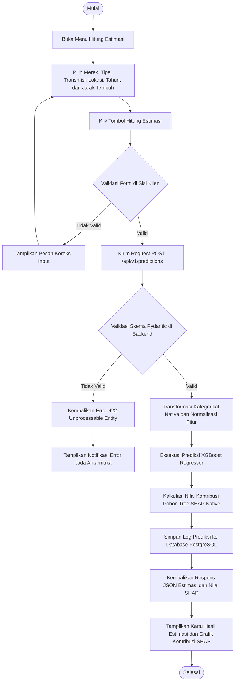

Gambar 4.3 Diagram aktivitas alur estimasi harga dan penjelasan SHAP

Diagram aktivitas pada Gambar 4.3 memperlihatkan tahapan inferensi mulai dari
pengisian formulir spesifikasi oleh pengguna, validasi data berlapis di sisi
klien dan server, eksekusi estimasi berbasis XGBoost, kalkulasi kontribusi fitur
secara lokal menggunakan Tree SHAP, pencatatan log audit ke basis data, hingga
penyajian hasil akhir berupa kartu harga dan grafik visual.

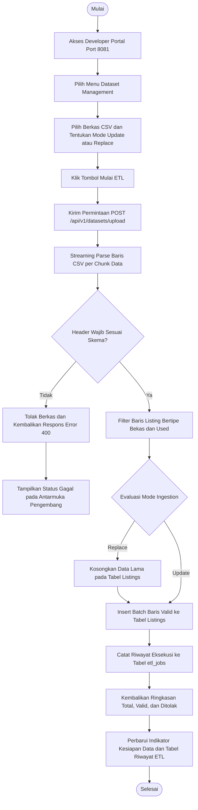

Gambar 4.4 Diagram aktivitas alur upload dataset dan eksekusi ETL

Diagram aktivitas pada Gambar 4.4 menunjukkan tata kelola dataset oleh pengembang
melalui Developer Portal. Berkas CSV diproses secara *streaming* per *chunk*
untuk menghemat alokasi memori, divalidasi kelengkapan kolomnya, disaring hanya
untuk listing kendaraan bekas, kemudian dicatat ke basis data sesuai mode
penambahan (*update*) atau penggantian total (*replace*).

### 4.2.2 Karakteristik Pengguna

Sistem dirancang untuk mengakomodasi dua profil pengguna dengan karakteristik
dan kebutuhan fungsional yang berbeda, seperti disajikan pada Tabel 4.2.

Tabel 4.2 Karakteristik pengguna sistem

| Pengguna | Deskripsi | Kebutuhan utama |
|---|---|---|
| User Umum | Pengguna publik yang ingin mengetahui estimasi harga mobil bekas | Input data kendaraan, estimasi harga, penjelasan faktor, dan statistik data |
| Developer | Pengguna teknis yang mengelola sistem | Overview sistem, upload dataset, ETL, katalog model, playground, dan akses API |

User Portal dirancang khusus untuk kenyamanan pengguna non-teknis: seluruh angka
berasal langsung dari API tanpa kalkulasi tiruan di frontend, hasil dinyatakan
sebagai estimasi model dan bukan harga mutlak transaksi, serta antarmuka ramah
navigasi papan ketik (*keyboard-only friendly*). Sebaliknya, Developer Portal
ditujukan untuk kebutuhan pemantauan teknis dan diisolasi pada port *loopback*.

### 4.2.3 Batasan Produk Dikembangkan

Batasan berikut ditetapkan secara tegas agar ruang lingkup pengujian *proof-of-concept*
tetap terkendali dan fokus pada tujuan penelitian:

1. Model terfokus pada algoritma tunggal XGBoost Regressor. Pengujian komparasi
   multi-model seperti Random Forest, LightGBM, atau Voting Regressor berada di
   luar ruang lingkup Capstone Project dan direncanakan untuk tahap Tugas Akhir.
2. Penjelasan fitur menggunakan kontribusi pohon native XGBoost (*Tree SHAP
   in-engine*), bukan metode aproksimasi LIME atau library runtime SHAP eksternal
   saat melayani permintaan inferensi.
3. Pelatihan model bersifat *offline* dan manual melalui skrip `ml/scripts/train_baseline.py`.
   Sistem tidak menyediakan endpoint pelatihan otomatis (*auto-retraining*)
   maupun *auto-deploy* ke lingkungan operasional.
4. Sistem tidak mencakup deteksi pergeseran konsep data (*concept drift*) atau
   pergeseran distribusi (*data drift*).
5. Sistem tidak menyediakan modul rekomendasi multikriteria (MCDM) untuk perangkingan
   kendaraan dan tidak melakukan penarikan data (*scraping*) langsung dari web. Data yang
   digunakan merupakan dataset sekunder hasil *scraping* website Mobil123 tahun 2025 yang
   bersumber dari repositori GitHub [aliabdurrahman10/Used-Car-Analysis-in-Indonesia](https://github.com/aliabdurrahman10/Used-Car-Analysis-in-Indonesia).
6. Sistem tidak menerapkan sistem autentikasi pengguna bertingkat yang kompleks
   (RBAC), karena prototipe difungsikan untuk demonstrasi Capstone Project dengan
   pengamanan akses pengembang melalui isolasi jaringan lokal (*loopback*).
7. Portal web tidak mengeksekusi kode arbitrer yang dimasukkan oleh pengguna.

## 4.3 Requirements Pengembangan Produk

### 4.3.1 Hardware

Perangkat keras yang digunakan untuk pelatihan model, pengujian sistem, dan
menjalankan lima kontainer Docker memiliki spesifikasi sebagai berikut:

| Komponen | Spesifikasi | Fungsi |
|---|---|---|
| Processor (CPU) | AMD Ryzen 7 5700X | Komputasi pemrosesan data, pelatihan model XGBoost, dan runtime backend |
| Memori (RAM) | 32 GB (2 x 16 GB) | Menampung dataset, in-memory model cache, dan operasional seluruh kontainer |
| Kartu Grafis (GPU) | NVIDIA GeForce RTX 3050 6 GB | Akselerasi grafis lingkungan komputasi pengembangan |
| Penyimpanan (Storage) | SSD NVMe | Media penyimpanan dataset, file artefak model, dan basis data PostgreSQL |

### 4.3.2 Software

Tabel 4.3 Spesifikasi perangkat lunak sistem

| Kategori | Perangkat lunak | Fungsi |
|---|---|---|
| Bahasa | Python 3.11+, JavaScript/Node.js | Backend, ML, dan frontend |
| Backend | FastAPI, Uvicorn, Pydantic | API dan validasi data |
| Frontend | ReactJS (Vite multi-page), Tailwind CSS | Antarmuka dua portal |
| ML | XGBoost, pandas, NumPy, scikit-learn, Joblib, Pytest | Pelatihan, inferensi, dan pengujian |
| Basis data | PostgreSQL 16, SQLAlchemy 2.0, pgAdmin 4 | Penyimpanan dan administrasi |
| Infrastruktur | Nginx Alpine, Docker Engine, Docker Compose v2 | Reverse proxy dan kontainerisasi |

### 4.3.3 Functional Requirement

Tabel 4.4 Kebutuhan fungsional (*Functional Requirement*)

| Kode | Kebutuhan fungsional | Sumber |
|---|---|---|
| FR-01 | Sistem memvalidasi input prediksi (`brand`, `brand_type`, `machine_type`, `location`, `year`, `km_1`, `km_2`). | `POST /predictions` |
| FR-02 | Sistem menghitung estimasi harga memakai XGBoost dan mengembalikan `model_version` serta `currency`. | `POST /predictions` |
| FR-03 | Sistem mengembalikan penjelasan SHAP per fitur dalam bentuk `base_value` dan daftar `shap_value`. | `POST /predictions` |
| FR-04 | Sistem menyimpan log prediksi (`input_payload` dan `shap_payload`) ke PostgreSQL secara *best-effort*. | `POST /predictions` |
| FR-05 | Sistem menampilkan detail prediksi berdasarkan `prediction_id`. | `GET /predictions/{id}` |
| FR-06 | Sistem menampilkan metadata model aktif beserta metrik per split. | `GET /models/active` |
| FR-07 | Sistem menampilkan katalog seluruh versi model dan metriknya. | `GET /models` |
| FR-08 | Sistem memvalidasi dan memproses upload CSV dengan mode Update atau Replace. | `POST /datasets/upload` |
| FR-09 | Sistem menyediakan daftar dataset dan riwayat job ETL. | `GET /datasets`, `GET /datasets/{id}`, `GET /etl/jobs` |
| FR-10 | Sistem menyediakan overview diagnostik untuk Developer Portal. | `GET /developer/overview` |
| FR-11 | Sistem menyediakan statistik agregat listing untuk dashboard. | `GET /stats/dataset` |
| FR-12 | Sistem menyediakan endpoint kesehatan yang melaporkan kesiapan model. | `GET /health` |
| FR-13 | User Portal menampilkan formulir, kartu hasil estimasi, dan visual SHAP. | Frontend user |
| FR-14 | Developer Portal menyediakan enam modul (overview, datasets, ETL, models, playground, API explorer). | Frontend developer |

### 4.3.4 Non-Functional Requirement

Tabel 4.5 Kebutuhan non-fungsional (*Non-Functional Requirement*)

| Kode | Kebutuhan non-fungsional |
|---|---|
| NFR-01 | Reproducibility: training memakai random seed 42, membagi data 80/20, dan menyimpan konfigurasi pada artefak terversi. |
| NFR-02 | Validasi batas: `1930 <= year <= 2026`, `0 <= km <= 1.000.000`, dan harga hasil prediksi tidak boleh negatif (dapat dikonfigurasi via env `MIN_YEAR`, `MAX_YEAR`, `MAX_KM`). |
| NFR-03 | Performa: inferensi dibatasi batas waktu `INFERENCE_TIMEOUT_S` (mengembalikan status HTTP 504 bila terlampaui). |
| NFR-04 | Efisiensi: model dan preprocessor dimuat satu kali saat startup, tanpa pembacaan ulang disk per request. |
| NFR-05 | Keamanan jaringan: PostgreSQL tidak diekspos ke host publik, Developer Portal hanya diikat pada `127.0.0.1`, dan Nginx memblokir akses silang antar portal (HTTP 404). |
| NFR-06 | Isolasi rilis: modul developer tidak pernah masuk ke dalam bundle publik; unggahan diproses *streaming* tanpa memuat seluruh berkas ke RAM. |
| NFR-07 | Usability: antarmuka adaptif pada breakpoint 768px, ramah navigasi keyboard, memenuhi kontras WCAG AA, dan bebas dari karakter emoji. |
| NFR-08 | Observability: prediksi dicatat ke basis data secara *best-effort* tanpa menghambat waktu tanggap pengguna. |
| NFR-09 | Portabilitas: seluruh layanan berjalan menggunakan `docker compose up` dan bergantung pada berkas konfigurasi `.env`. |
| NFR-10 | Keandalan artefak: berkas model di-mount ke backend sebagai volume baca saja (*read-only*). |

## 4.4 Solusi Ditawarkan

### 4.4.1 Solusi 1

Solusi yang dirancang adalah sistem pendukung keputusan estimasi harga mobil bekas
berbasis algoritma XGBoost Regressor dengan penjelasan terintegrasi (*Explainable AI*)
menggunakan Tree SHAP, yang disajikan melalui arsitektur aplikasi web portal ganda:

- Model prediksi memanfaatkan keunggulan XGBoost dalam mengelola fitur kategorikal
  secara native (`enable_categorical=true`). Karakteristik berkardinalitas tinggi
  seperti `brand_type` (mencapai 2.002 nilai unik) dipertahankan sebagai tipe data
  `pandas.Categorical` murni tanpa ekspansi One-Hot Encoding yang membebani dimensi.
- Penjelasan lokal dihitung menggunakan kontribusi pohon native XGBoost
  `Booster.predict(pred_contribs=True)` yang diagregasi kembali ke enam fitur
  semantik, menjamin prinsip aditivitas matematika dalam hitungan milidetik.
- Arsitektur backend dibangun di atas FastAPI dengan penerapan pola *repository*
  dan *dependency injection*, memisahkan logika orkestrasi inferensi dari manipulasi
  basis data.
- Sistem mengoperasikan dua portal antarmuka yang terisolasi secara fisik dan
  jaringan: User Portal pada port 80 untuk masyarakat umum dan Developer Portal
  pada port 8081 untuk operasional data dan pengujian teknis.
- Seluruh ekosistem dikemas dalam kontainer Docker terpadu dengan basis data
  PostgreSQL 16 untuk menyimpan riwayat transaksi listing, log prediksi, dan
  audit jejak ETL.

### 4.4.2 Proses Pemilihan Solusi

Keputusan teknis pada perancangan produk diambil berdasarkan perbandingan komparatif
terhadap beberapa alternatif, seperti dirangkum pada Tabel 4.6.

Tabel 4.6 Perbandingan alternatif dan dasar pemilihan solusi

| Aspek | Alternatif | Dipilih | Alasan |
|---|---|---|---|
| Encoding kategorikal | One-Hot Encoding, Ordinal Encoding, native `pandas.Categorical` | Native `pandas.Categorical` | Fitur `brand_type` memiliki 2.002 varian, sehingga One-Hot mengakibatkan ledakan dimensi matriks dan Ordinal menimbulkan bias urutan serta risiko leakage |
| Explainability | Library Python `shap`, kontribusi pohon native XGBoost | Kontribusi native `pred_contribs=True` | Menjamin sifat aditif `base_value + sum(shap) = prediksi`, waktu inferensi dalam hitungan milidetik, dan meniadakan dependensi library eksternal saat runtime |
| Representasi kilometer | Mempertahankan `KM_1` dan `KM_2`, memilih satu fitur | Memilih `km_1` | `KM_1` dan `KM_2` memiliki nilai korelasi Pearson 0,999 sehingga bersifat redundan |
| Arsitektur portal | Aplikasi tunggal gabungan, portal terpisah | Dua portal terpisah | Mengisolasi akses fungsi publik dari fungsi administratif dan dataset, dengan Developer Portal diikat ke alamat lokal loopback |
| Pelatihan model | Pelatihan otomatis via endpoint API, pelatihan offline manual | Pelatihan offline manual | Menjaga stabilitas artefak produksi dan mencegah perubahan model tanpa melalui evaluasi validasi yang ketat |
| Fitur teks mentah | Mengekstrak teks deskripsi, mengecualikan teks mentah | Mengecualikan teks mentah | Menghindari risiko kebocoran data (*data leakage*) dan menjaga ruang lingkup model pada atribut kendaraan yang terukur |

### 4.4.3 Desain Produk Diusulkan

Desain arsitektur produk mengintegrasikan interaksi antara pengguna, gerbang
keamanan web, layanan backend, engine pembelajaran mesin, serta basis data
penyimpanan. Topologi arsitektur sistem digambarkan pada Gambar 4.5.

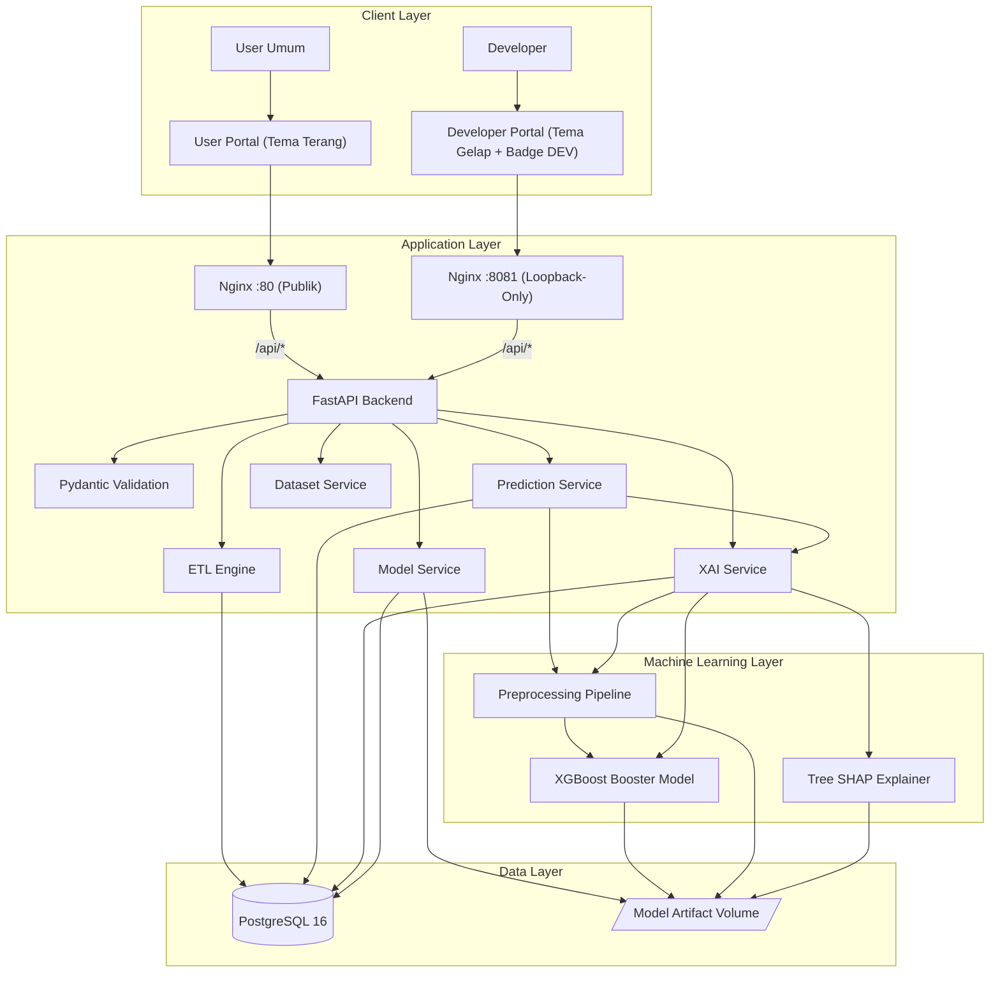

Gambar 4.5 Ringkasan topologi sistem OtoValue

Topologi arsitektur sistem OtoValue dirancang dengan memisahkan client, application gateway, machine learning engine, dan persistence layer untuk menjaga modularitas serta keamanan data. Pengguna umum mengakses User Portal melalui reverse proxy Nginx port 80 publik, sedangkan pengelola sistem mengakses Developer Portal melalui port 8081 yang diisolasi khusus antarmuka loopback 127.0.0.1. Seluruh permintaan data dan komputasi diteruskan ke FastAPI untuk divalidasi oleh Pydantic, kemudian diproses oleh Prediction Service atau ETL Engine. Model XGBoost dan preprocessor dimuat langsung ke memori dari volume artefak read-only saat aplikasi dijalankan, sementara riwayat transaksi, log prediksi, dan audit ETL disimpan pada basis data relasional PostgreSQL.

Untuk memperjelas urutan pertukaran pesan antar komponen dalam sistem, interaksi
antar layer dimodelkan menggunakan diagram sekuens (*sequence diagram*). Gambar 4.6
menampilkan diagram sekuens untuk alur inferensi harga dan penjelasan fitur,
sedangkan Gambar 4.7 menyajikan diagram sekuens untuk alur upload dan pemrosesan ETL.

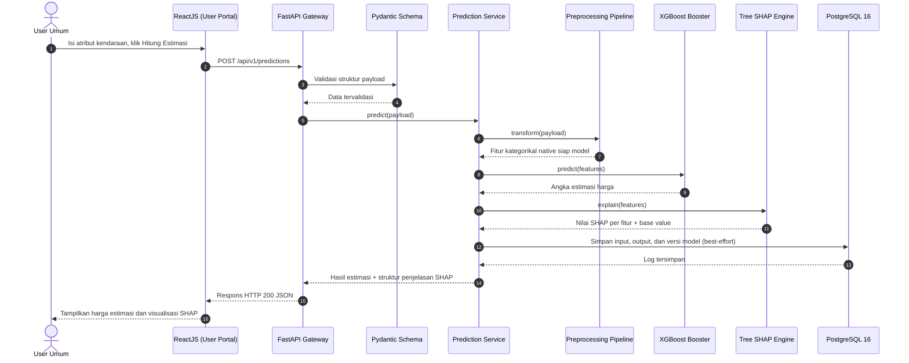

Gambar 4.6 Diagram sekuens alur estimasi harga dan penjelasan SHAP

Pada Gambar 4.6, seluruh permintaan prediksi dari klien diarahkan ke API Gateway,
divalidasi tipe datanya oleh Pydantic, kemudian ditransformasikan oleh pipeline
prapemrosesan ke dalam representasi kategorikal native. Model XGBoost menghitung nilai
estimasi harga dan engine Tree SHAP mengekstrak kontribusi lokal dari setiap fitur.
Log inferensi disimpan ke PostgreSQL secara *best-effort* sehingga keterlambatan
pencatatan database tidak akan menghambat pengiriman respons JSON kepada pengguna.

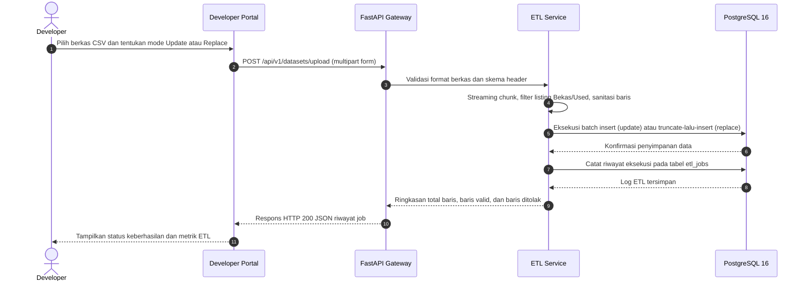

Gambar 4.7 Diagram sekuens alur upload dataset dan eksekusi ETL

Pada Gambar 4.7, pengembang mengunggah berkas CSV multipart ke API Gateway.
Layanan ETL membaca data dalam bentuk *stream* per bongkahan (*chunk*), memvalidasi
kepatuhan header terhadap skema basis data, membuang data listing baru, serta
melakukan operasi penambahan (*append*) atau penggantian menyeluruh (*replace*) ke
tabel `listings`. Setelah transaksi basis data selesai, ringkasan jumlah baris
disimpan ke riwayat audit ETL dan dilaporkan kembali ke Developer Portal.

Struktur basis data relasional dirancang menggunakan enam tabel terhubung. Diagram
hubungan entitas (*Entity-Relationship Diagram*) disajikan pada Gambar 4.8.

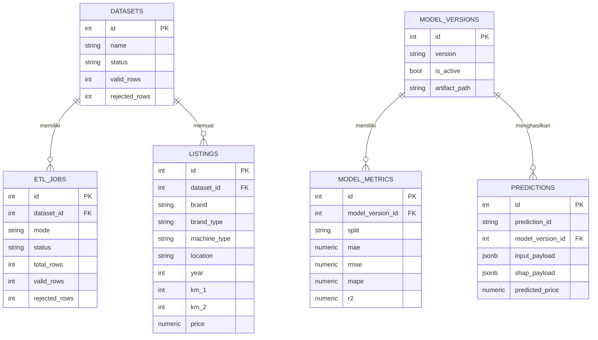

Gambar 4.8 ERD enam tabel basis data OtoValue

Komunikasi data antara antarmuka klien dan backend diatur melalui kontrak REST API
dengan *base URL* `/api/v1`. Ringkasan endpoint disajikan pada Tabel 4.7.

Tabel 4.7 Ringkasan kontrak REST API `/api/v1`

| Method | Endpoint | Fungsi | Keterangan |
|---|---|---|---|
| GET | `/health` | Pemeriksaan kesehatan layanan | Mengembalikan status kesiapan backend dan versi model aktif |
| POST | `/predictions` | Perhitungan estimasi dan XAI | Menerima atribut mobil, mengembalikan estimasi harga dan nilai SHAP |
| GET | `/predictions/{id}` | Audit riwayat prediksi | Menampilkan data input, prediksi, dan penjelasan berdasarkan ID |
| GET | `/models/active` | Metadata model aktif | Menampilkan informasi konfigurasi model aktif dan skor evaluasinya |
| GET | `/models` | Katalog seluruh versi model | Menampilkan daftar seluruh versi model pada registri beserta metrik |
| POST | `/datasets/upload` | Upload dan ingestion data | Menerima berkas CSV multipart dan mengeksekusi pipeline ETL |
| GET | `/datasets` | Daftar metadata dataset | Menampilkan riwayat dataset yang terdaftar beserta ringkasan status |
| GET | `/datasets/{id}` | Rincian metadata dataset | Menampilkan detail statistik dataset tertentu dan log ETL terkait |
| GET | `/etl/jobs` | Riwayat eksekusi ETL | Menampilkan daftar log audit pekerjaan pemrosesan data |
| GET | `/developer/overview` | Ringkasan operasional sistem | Mengagregasi status koneksi backend, basis data, model, dan ETL |
| GET | `/stats/dataset` | Statistik agregat listing | Mengembalikan metrik ringkasan, distribusi harga, transmisi, dan tahun |

Untuk menjamin keamanan arsitektur, isolasi jaringan diterapkan menggunakan Nginx
dengan konfigurasi port terpisah, seperti dirangkum pada Tabel 4.8.

Tabel 4.8 Topologi deployment dan isolasi jaringan

| Layanan | Image dasar | Akses port host | Peran dan kebijakan isolasi |
|---|---|---|---|
| `nginx` | `nginx:alpine` | `:80` publik, `:8081` loopback | Reverse proxy dua gerbang: port 80 publik memblokir aset developer (HTTP 404), port 8081 hanya menerima request dari 127.0.0.1 dan membuka Swagger UI |
| `frontend` | Multi-stage Node / Nginx | Internal container | Menyajikan dua entry point terisolasi: `index.html` publik dan `developer.html` |
| `backend` | `python:3.11-slim` | Internal container | Menjalankan FastAPI, runtime XGBoost, kalkulator Tree SHAP, dan parser ETL |
| `postgres` | `postgres:16-alpine` | Jaringan internal Docker | Menyimpan 6 tabel relasional; tidak diekspos langsung ke port jaringan host |
| `pgadmin` | `dpage/pgadmin4:9` | `:5050` (localhost) | Administrasi database grafis lokal dalam mode desktop passwordless |

### 4.4.4 Arsitektur Data dan Pipeline Machine Learning

Tahap persiapan data dan pemodelan machine learning dirancang secara terstruktur
mengikuti temuan eksplorasi data mentah dan kaidah reproduksibilitas ilmiah.

#### 1. Karakteristik Dataset dan Keputusan Pengolahan Data

**Disclaimer Sumber Dataset**:
Dataset mentah `dataset.csv` yang digunakan dalam penelitian dan pengembangan sistem ini merupakan **dataset sekunder** hasil penarikan data (*web scraping*) pada portal jual-beli mobil **Mobil123** pada tahun 2025. Dataset ini bersumber dari repositori terbuka https://github.com/aliabdurrahman10/Used-Car-Analysis-in-Indonesia oleh Ali Abdurrahman. Sistem OtoValue memanfaatkan dataset sekunder terkurasi ini untuk pelatihan, validasi, dan pengujian model, serta tidak melakukan aktivitas *scraping* secara langsung (*real-time scraping*) terhadap situs web pihak ketiga.

Dataset mentah `dataset.csv` berisi 22.679 baris dan 14 kolom dengan target harga
(`price`) tanpa nilai yang hilang (*missing value*). Analisis karakteristik data
menghasilkan keputusan sebagai berikut:
- **Penyaringan jenis listing**: Eksperimen utama secara ketat hanya menyertakan
  data listing `Bekas` dan `Used` (berjumlah 21.553 baris). Data listing `Baru`
  (1.126 baris) dieleminasi karena objek penelitian berfokus pada dinamika harga
  mobil bekas.
- **Pengecualian indeks dan teks bebas**: Kolom `Unnamed: 0` diperlakukan sebagai
  nomor indeks baris dan diabaikan dari pemodelan. Kolom teks bebas (`item`,
  `ellipsize`, dan `listing__excerpt`) tidak digunakan pada model baseline untuk
  mencegah kebocoran data (*data leakage*) dan menjaga ruang lingkup fitur.
- **Penanganan redundansi jarak tempuh**: Analisis korelasi Pearson menunjukkan
  bahwa atribut `KM_1` dan `KM_2` memiliki nilai korelasi 0,999 (mendekati 1,000),
  sehingga keduanya redundan. Sistem menetapkan `km_1` sebagai representasi utama,
  dengan `km_2` difungsikan sebagai nilai cadangan (*fallback*) apabila `km_1`
  tidak terisi pada permintaan input pengguna.
- **Kardinalitas tinggi tipe kendaraan**: Atribut `brand_type` memiliki kardinalitas
  sangat tinggi dengan 2.002 varian unik. Penerapan One-Hot Encoding akan menghasilkan
  matriks fitur yang terlampau lebar dan jarang (*sparse matrix*), sementara Ordinal
  Encoding akan memaksakan urutan nilai buatan. Oleh karena itu, fitur kategorikal
  dipertahankan menggunakan representasi `pandas.Categorical` murni dan diproses
  langsung oleh kemampuan pohon XGBoost melalui konfigurasi `enable_categorical=true`.

#### 2. Pipeline Pelatihan dan Artefak Terversi
Pelatihan model dilakukan menggunakan skrip mandiri `ml/scripts/train_baseline.py`
dengan tata urutan reproducible:
1. Memuat dataset bersih hasil filter (21.553 baris).
2. Membagi dataset menjadi 80% data latih (17.242 baris) dan 20% data uji (4.311 baris)
   menggunakan pembagian acak terkendali dengan *random seed* bernilai 42.
3. Melatih `XGBRegressor` dengan parameter: `n_estimators=300`, `max_depth=6`,
   `learning_rate=0.08`, `subsample=0.85`, `colsample_bytree=0.85`, serta
   `enable_categorical=True`.
4. Mengevaluasi metrik kinerja model pada data uji (*test set*).
5. Mengekspor bundel artefak terpadu ke direktori `artifacts/models/xgboost/xgb-v1/`
   yang mencakup enam berkas kontrak: `model.json` (arsitektur dan bobot pohon),
   `preprocessing.joblib` (objek preprocessor kategorikal), `feature_schema.json`
   (definisi skema input), `metrics.json` (skor evaluasi per split),
   `training_config.json` (catatan parameter dan random seed), serta `shap_config.json`
   (konfigurasi representasi XAI).

Model aktif `xgb-v1` menghasilkan skor evaluasi performa pada data uji sebagai
berikut:
- *Mean Absolute Error* (MAE): Rp25.446.042
- *Root Mean Squared Error* (RMSE): Rp52.997.228
- *Mean Absolute Percentage Error* (MAPE): 8,40%
- *Koefisien Determinasi* ($R^2$): 0,9371

#### 3. Komputasi Tree SHAP dan Jaminan Aditivitas
Penjelasan nilai kontribusi fitur dihitung langsung di backend menggunakan modul
native XGBoost Booster `predict(..., pred_contribs=True)`. Metode ini mengekstrak
nilai dasar ekspektasi rata-rata (*base value*) dan nilai kontribusi lokal ($\phi_i$)
untuk setiap fitur pada observasi bersangkutan. Formulasi aditivitas terpenuhi secara
matematis:

$$	ext{Prediksi} = 	ext{Base Value} + \sum_{i=1}^{m} \phi_i$$

Karena kalkulasi dijalankan langsung oleh engine pohon C++ bawaan XGBoost, proses
penjelasan fitur selesai dalam waktu di bawah 15 milidetik per permintaan tanpa
memerlukan instalasi pustaka Python `shap` pada saat runtime pelayanan inferensi.
Selisih residu antara penjumlahan nilai SHAP dan angka prediksi terverifikasi berada
di bawah Rp116 (diakibatkan oleh pembulatan representasi bilangan pecahan *float32*),
jauh di bawah batas toleransi deviasi yang ditetapkan yaitu Rp1.000.

### 4.4.5 Rencana Implementasi dan Pengujian

#### Gantt Chart Pelaksanaan Proyek
Pengembangan sistem OtoValue dilaksanakan melalui tujuh fase dengan
estimasi rentang waktu pengerjaan selama lima minggu, sebagaimana dirangkum pada
Tabel 4.9.

Tabel 4.9 Jadwal rencana pelaksanaan proyek (Gantt Chart)

| Fase Pengembangan | Minggu 1 | Minggu 2 | Minggu 3 | Minggu 4 | Minggu 5 |
|---|:---:|:---:|:---:|:---:|:---:|
| Fase 1: Analisis Kebutuhan | X | | | | |
| Fase 2: Perancangan Sistem | X | | | | |
| Fase 3: Persiapan Data dan ML | | X | | | |
| Fase 4: Implementasi Sistem | | X | X | | |
| Fase 5: Integrasi dan Pengujian | | | | X | |
| Fase 6: Deployment Kontainer | | | | X | X |
| Fase 7: Pemeliharaan dan Evaluasi | | | | | X |

#### Metode Pengujian Terpusat
Pengujian sistem dilakukan secara berjenjang menggunakan rangkaian lima suite
pengujian mandiri yang terpusat di dalam direktori `testing/`, seperti dirinci
pada Tabel 4.10.

Tabel 4.10 Rangkaian lima suite pengujian sistem

| Suite | Skrip pengujian | Fokus pengujian | Kriteria keberhasilan |
|---|---|---|---|
| Suite 1 | `1_data_validation.py` | Profiling dataset mentah dan kepatuhan aturan penolakan ETL | Memastikan 22.679 baris mentah, 21.553 baris Bekas/Used, korelasi jarak tempuh 0,999, serta verifikasi 8 skenario penolakan data invalid |
| Suite 2 | `2_unit_testing.py` | Unit test backend Pytest dalam memori SQLite dan analisis statis | Menjalankan 17 uji unit backend (lolos 100%), kompilasi statis `compileall` bersih, dan uji pemformat mata uang Rupiah |
| Suite 3 | `3_integration_testing.py` | Integrasi endpoint REST API live dan isolasi keamanan Nginx | Memastikan seluruh endpoint mengembalikan status HTTP 200, penolakan mode invalid (HTTP 400), serta isolasi silang port 80 dan 8081 |
| Suite 4 | `4_functional_testing.py` | Verifikasi build produksi antarmuka dan matriks fungsi use case | Memverifikasi pemisahan chunk developer dari bundle publik, verifikasi 0 emoji, dan kepatuhan skenario use case UC1 sampai UC12 |
| Suite 5 | `5_model_xai_validation.py` | Integritas artefak model, reproduksibilitas, dan aditivitas SHAP | Menjamin keberadaan 6 berkas artefak, keberhasilan retrain seed 42 ($R^2 \ge 0,93$, MAPE $\le 9\%$), dan residu SHAP $\le 	ext{Rp1.000}$ |

## 4.5 Implementasi

### 4.5.1 Aplikasi Dokumen

Seluruh kode program, konfigurasi infrastruktur, dan dokumentasi proyek dikelola
secara tersentralisasi pada repositori publik GitHub:

- **Tautan Repositori Resmi**: [https://github.com/RistoKuy/XAI_Car_CP](https://github.com/RistoKuy/XAI_Car_CP)

#### Dokumen dan Berkas Pendukung Repositori
Repositori proyek memuat berkas-berkas utama yang mendefinisikan keseluruhan sistem:
- `README.md`: Berkas dokumentasi utama yang memuat panduan komprehensif, arsitektur, spesifikasi teknis, dan laporan pengujian produk.
- `dataset.csv`: Berkas dataset sekunder mentah berisi 22.679 baris data pasar mobil bekas hasil *scraping* portal Mobil123 pada tahun 2025 dari repositori https://github.com/aliabdurrahman10/Used-Car-Analysis-in-Indonesia.
- `AGENTS.md`: Dokumen kontrak teknis, aturan rekayasa, dan panduan standar eksekusi.
- `docker-compose.yml`: Berkas konfigurasi orkestrasi multi-kontainer Docker untuk lima
  layanan utama.
- `.env.example`: Berkas templat variabel lingkungan untuk konfigurasi sistem yang
  aman tanpa *hardcoding*.
- Direktori `artifacts/models/xgboost/xgb-v1/`: Paket artefak terversi yang menyimpan
  bobot model `model.json`, preprocessor `preprocessing.joblib`, skema fitur, dan
  metrik evaluasi.
- Direktori `testing/`: Skrip orkestrator dan lima suite pengujian otomatis (`run_all.py`
  serta `1_data_validation.py` sampai `5_model_xai_validation.py`).
- Direktori `docs/figures/`: Aset gambar laporan. `bab4/` menyimpan 8 diagram BAB IV
  sebagai PNG RGBA transparan (Gambar 4.1-4.8, hasil render `@mermaid-js/mermaid-cli`
  dengan `-b transparent -s 3`), sedangkan `views/` menyimpan 10 tangkapan layar
  antarmuka (Gambar 4.9-4.18) yang dilampirkan pada §4.5.2. Berkas di dalamnya adalah
  aset biner, bukan dokumentasi naratif.

#### Struktur Direktori Codebase
Organisasi berkas pada repositori dirancang secara modular dan datar:

```text
frontend/                  # Aplikasi ReactJS (Vite multi-page: index.html & developer.html)
  src/
    layouts/               # Shell antarmuka DesktopView, MobileView, dan DeveloperShell
    developer/             # Entry point dan komponen khusus Developer Portal
    components/            # Komponen visual reusable (VehicleForm, Card, SHAP Chart)
    pages/                 # Halaman Home, Prediction, DataDashboard, dan modul dev
    services/hooks/utils/  # api.js, usePrediction.js, formatCurrency.js
  nginx.conf               # Konfigurasi reverse proxy internal container frontend
backend/                   # Layanan backend FastAPI berbasis arsitektur berlapis
  app/api/                 # Modul route handler (health, predict, model, dataset, etl, stats)
  app/core/                # Konfigurasi aplikasi dan variabel lingkungan
  app/db/                  # Koneksi basis data dan inisialisasi tabel SQLAlchemy
  app/ml/                  # Preprocessor kategorikal native dan logika model manager
  app/repositories/        # Pola repository untuk pemisahan query database
  app/schemas/             # Validasi skema request dan response berbasis Pydantic
  app/services/            # Logika bisnis domain (prediction, etl, stats, model manager)
testing/                   # Rangkaian lima suite pengujian otomatis mandiri
  run_all.py               # Skrip master orchestrator pengujian
  1_data_validation.py     # Suite 1: Validasi data dan aturan ingestion ETL
  2_unit_testing.py        # Suite 2: Unit testing backend dan analisis statis
  3_integration_testing.py # Suite 3: Pengujian integrasi REST API dan batas isolasi port
  4_functional_testing.py  # Suite 4: Pengujian fungsional UI dan audit kualitas frontend
  5_model_xai_validation.py# Suite 5: Validasi integritas artefak dan aditivitas Tree SHAP
ml/scripts/                # Skrip offline (profile_dataset, train_baseline, seed_db)
data/processed/            # Tempat penyimpanan dataset bersih terfilter (diabaikan git)
artifacts/models/          # Direktori registri artefak model terversi (xgb-v1)
infra/nginx/               # Konfigurasi Nginx reverse proxy dua port (:80 dan :8081)
infra/pgadmin/             # Berkas prapendaftaran koneksi servers.json
docs/figures/              # Aset gambar laporan (bab4/ PNG transparan, views/ tangkapan layar)
docker-compose.yml         # Konfigurasi orkestrasi kontainer Docker
.env.example               # Templat parameter variabel lingkungan
```

#### Penjelasan Komprehensif Arsitektur Codebase
Codebase OtoValue dibangun mengikuti prinsip pemisahan tanggung jawab (*Separation
of Concerns*) melalui enam lapisan arsitektur utama:

1. **Presentation Layer (`frontend/src/`)**:
   - *Dual-SPA Multi-Page Entry*: Menggunakan arsitektur multi-halaman pada Vite
     untuk menghasilkan dua bundle terpisah: `index.html` (`src/main.jsx`) untuk
     pengguna umum dan `developer.html` (`src/developer/main.jsx`) untuk pengembang.
     Kode modul pengembang dipecah ke dalam chunk terpisah (`developer-*.js`) agar
     tidak membebani dan tidak bocor ke dalam bundle publik.
   - *Adaptive Shell Switcher*: Hook `useWindowSize` mengelola tata letak secara
     reaktif pada breakpoint 768px. Layar lebar menggunakan `DesktopView` dengan
     navigasi sidebar statis, sedangkan layar kecil secara otomatis beralih ke
     `MobileView` dengan hamburger menu dan *bottom navigation bar*.
   - *Reusable Visual Components*: Komponen inti seperti formulir `VehicleForm`,
     kartu hasil `PredictionCard`, grafik air terjun `ShapWaterfall`, dan grafik
     batang `ShapBarChart` digunakan secara konsisten pada User Portal maupun pada
     Playground di Developer Portal.
   - *Native SVG Data Dashboard*: Modul `DataDashboard.jsx` menyajikan distribusi
     data listing (histogram harga, proporsi transmisi, ranking merek, dan sebaran
     tahun) menggunakan elemen visual SVG native murni tanpa library visualisasi
     pihak ketiga, menjamin kecepatan rendering dan ukuran bundle yang ringan.
   - *Client Services & Hooks*: Modul `services/api.js` mengelola panggilan jaringan
     dengan timeout terkendali, `hooks/usePrediction.js` mengelola *state machine*
     inferensi (idle, loading, success, error), dan `utils/formatCurrency.js`
     memformat nilai moneter ke standar Rupiah.

2. **Ingress & Reverse Proxy Layer (`infra/nginx/`)**:
   - *Port 80 (Gerbang Publik)*: Menyajikan berkas statis User Portal, mem-proxy
     permintaan API berawalan `/api/` ke backend, serta secara eksplisit menolak
     dan memblokir akses ke `developer.html` atau aset bertanda developer dengan
     kode status HTTP 404.
   - *Port 8081 (Gerbang Loopback Pengembang)*: Dibatasi secara ketat pada antarmuka
     lokal `127.0.0.1`. Gerbang ini melayani Developer Portal, menyediakan akses
     ke dokumentasi interaktif Swagger UI (`/docs`, `/openapi.json`), dan mem-proxy
     permintaan API. Akses ke antarmuka publik `index.html` dari port ini diblokir
     dengan kode status HTTP 404.

3. **API & Web Gateway Layer (`backend/app/api/`, `backend/app/schemas/`)**:
   - *Lifespan Initialization Controller*: Terpusat pada `backend/app/main.py` untuk
     mengatur siklus hidup aplikasi saat startup: sinkronisasi pembuatan tabel basis
     data relasional melalui SQLAlchemy, pemanasan model aktif ke memori melalui
     `ModelManager`, serta eksekusi *seed* otomatis untuk metadata dan listing awal.
   - *Modular Route Handlers*: Terdiri dari rute-rute independen mencakup pemeriksaan
     kesehatan (`routes_health.py`), inferensi dan audit log (`routes_prediction.py`),
     informasi katalog model (`routes_model.py`), streaming upload berkas
     (`routes_dataset.py`), pemantauan riwayat ETL (`routes_etl.py`), diagnosa
     kesehatan sistem (`routes_developer.py`), dan kalkulasi statistik agregat
     (`routes_stats.py`).
   - *Pydantic Schema Validation*: Melakukan inspeksi ketat terhadap parameter input
     (misalnya tahun pembuatan kendaraan, nilai kilometer, dan harga) untuk mencegah
     injeksi data tidak valid sebelum menyentuh lapisan service.

4. **Domain & Service Layer (`backend/app/services/`)**:
   - *`ModelManager` (`model_manager.py`)*: Berperan sebagai singleton in-memory
     cache untuk model XGBoost dan preprocessor kategorikal. Berkas artefak dimuat
     hanya sekali saat inisialisasi aplikasi, meniadakan latensi disk I/O per request.
   - *`PredictionService` (`prediction_service.py`)*: Mengorkestrasi pipeline
     inferensi lengkap: evaluasi nilai fallback kilometer, transformasi kategorikal,
     pemanggilan booster pohon XGBoost, ekstraksi nilai kontribusi Tree SHAP native,
     agregasi nilai kembali ke enam fitur semantik, serta pencatatan log prediksi
     ke PostgreSQL secara *best-effort*.
   - *`ETLService` (`etl_service.py`)*: Mengelola proses ingestion berkas CSV multipart
     menggunakan mekanisme pembacaan *streaming chunk*, memvalidasi skema header,
     menyaring tipe listing, serta mengeksekusi operasi penulisan basis data dalam
     mode *update* (penambahan baris) maupun *replace* (pengosongan lalu penulisan ulang).
   - *`StatsService` (`stats_service.py`)*: Menghitung metrik analitik ringkasan
     langsung dari database (total unit, mean, median, min, max harga, distribusi
     transmisi, serta agregasi tahun dan lokasi) untuk kebutuhan visualisasi dashboard.

5. **Machine Learning & XAI Engine (`backend/app/ml/`, `artifacts/models/`)**:
   - *`CategoricalPreprocessor` (`categorical_preprocessor.py`)*: Mempertahankan
     tipe data kategori native pandas untuk fitur kardinalitas tinggi `brand_type`.
     Mengonversi kategori baru yang belum pernah dilihat saat pelatihan menjadi
     *missing category*, yang secara matematis didukung langsung oleh struktur
     percabangan pohon XGBoost.
   - *Native In-Engine Tree SHAP*: Penjelasan lokal dihitung langsung di backend
     melalui fitur internal booster XGBoost `Booster.predict(..., pred_contribs=True)`.
     Menghasilkan *base value* dan nilai kontribusi per fitur secara aditif dalam
     orde milidetik tanpa membutuhkan paket runtime eksternal.
   - *Versioned Artifact Bundle*: Disimpan dalam direktori terstruktur per versi
     pada `artifacts/models/xgboost/<version>/`, menjamin integritas antara bobot
     model, skema fitur, preprocessor, dan metrik performa yang tercatat.

6. **Repository & Persistence Layer (`backend/app/repositories/`, `backend/app/db/`)**:
   - *Pola Repository*: Mengisolasi kueri basis data dari logika bisnis aplikasi
     melalui `ListingRepository`, `ModelRepository`, dan `PredictionRepository`.
     Log prediksi disimpan dengan format JSONB pada kolom `input_payload` dan
     `shap_payload` untuk memudahkan penelusuran audit.
   - *SQLAlchemy 2.0 ORM*: Mengelola connection pooling dan transaksi basis data
     relasional PostgreSQL 16 secara efisien.

7. **Pipeline ML Offline & Reproducibility (`ml/scripts/`)**:
   - Skrip `profile_dataset.py` untuk pembersihan dan profiling dataset mentah.
   - Skrip `train_baseline.py` untuk pelatihan mandiri yang reproducible dengan *seed* 42.
   - Skrip `seed_db.py` untuk inisialisasi basis data PostgreSQL secara terpisah.

### 4.5.2 Tampilan Produk

Antarmuka produk dirancang untuk memberikan pengalaman navigasi yang intuitif,
transparan, dan informatif bagi masing-masing kelompok pengguna. Tangkapan layar
setiap halaman tersimpan di `docs/figures/views/` dan dilampirkan pada bagian ini.

#### 1. User Portal (Port 80)
User Portal melayani kebutuhan publik melalui tiga halaman utama:
- **Halaman Beranda**: Menyajikan pengantar sistem, ringkasan metodologi penaksiran
  harga berbasis data, serta menampilkan metrik evaluasi model aktif secara dinamis
  yang diambil langsung dari API backend.
- **Halaman Data Dashboard**: Menyajikan visualisasi data listing mobil bekas
  secara real-time melalui elemen grafik SVG native. Dashboard mencakup kartu ringkasan
  statistik (total listing, rata-rata harga, harga tengah), visualisasi histogram
  sebaran harga, diagram rasio jenis transmisi, perbandingan merek dan wilayah,
  serta sebaran tahun perakitan kendaraan.
- **Halaman Hitung Estimasi**: Menyediakan formulir masukan spesifikasi mobil
  (merek, tipe model, transmisi, lokasi, tahun pembuatan, dan jarak tempuh).
  Setelah pengguna menekan tombol hitung, sistem menampilkan kartu hasil estimasi
  harga dalam format Rupiah, disertai visualisasi penjelasan kontribusi fitur
  menggunakan grafik *waterfall* dan grafik batang interaktif yang membedakan pengaruh
  penambah harga (warna hijau/positif) dan pengurang harga (warna merah/negatif).

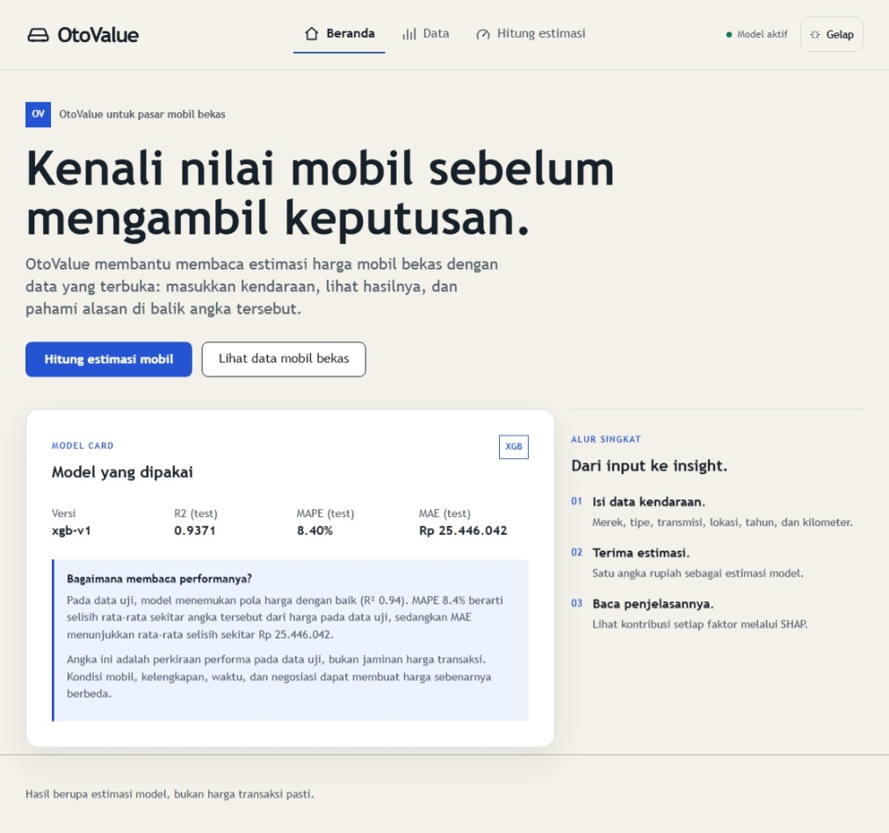

Gambar 4.9 Halaman Beranda User Portal

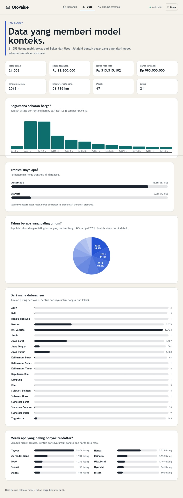

Gambar 4.10 Halaman Data Dashboard User Portal

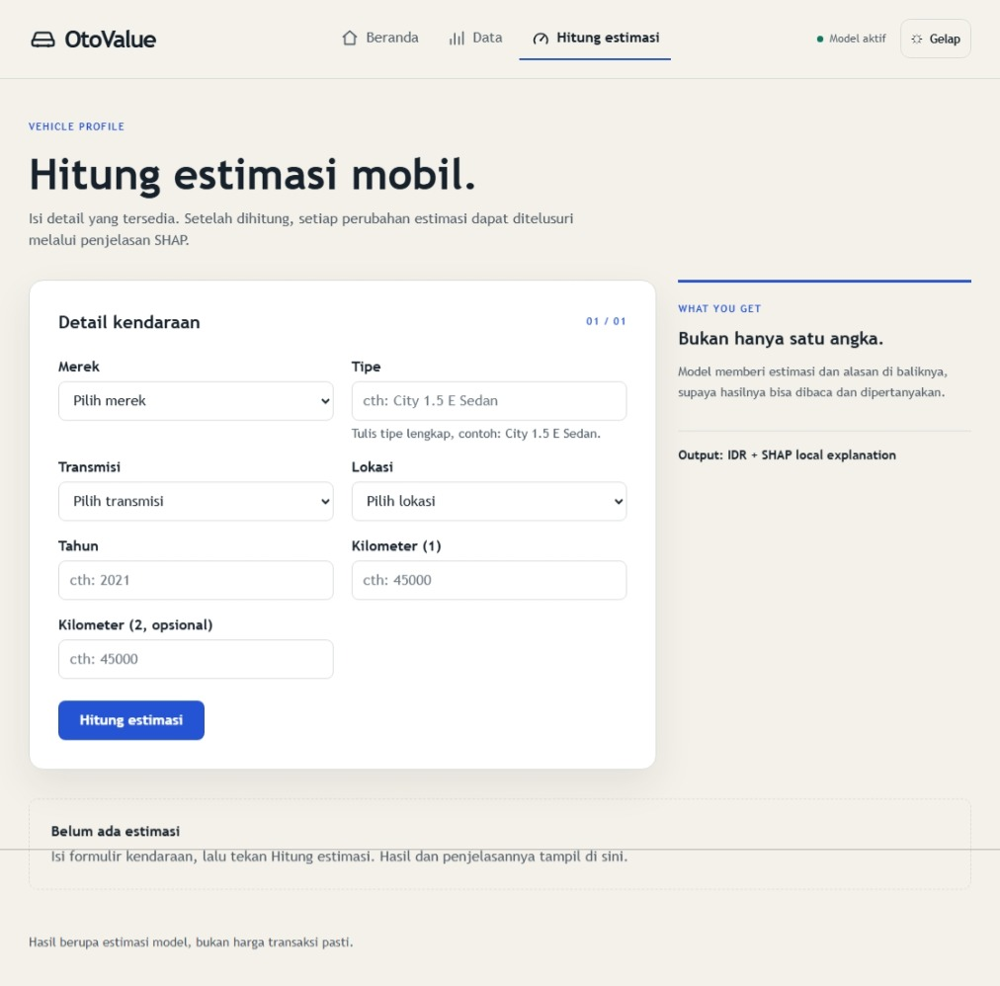

Gambar 4.11 Formulir Hitung Estimasi User Portal

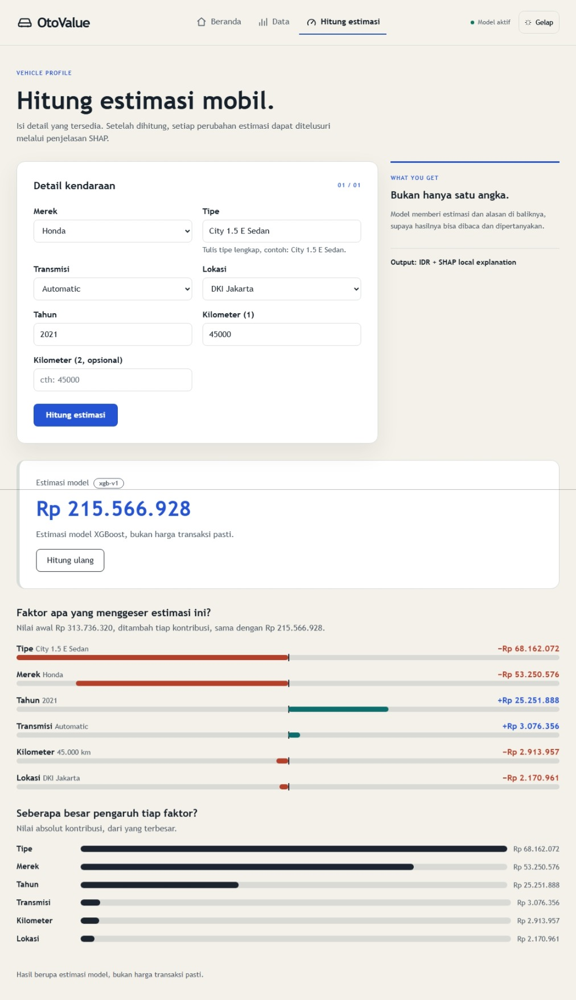

Gambar 4.12 Hasil estimasi harga dan visualisasi kontribusi Tree SHAP

#### 2. Developer Portal (Port 8081)
Developer Portal berfungsi sebagai konsol pemantauan dan pengelolaan teknis dengan
enam modul terpisah:
- **Business/System Overview**: Menampilkan status operasional backend, ketersediaan
  koneksi basis data, versi model aktif, dan kesiapan data ETL.
- **Dataset Management**: Menyediakan antarmuka unggah berkas CSV multipart dengan
  opsi mode **Update** (penambahan data) atau **Replace** (pengosongan lalu penulisan
  ulang data lama), dilengkapi tabel pemantauan dataset.
- **ETL Management**: Menampilkan riwayat eksekusi pekerjaan ETL secara terperinci,
  mencakup nama berkas, waktu pemrosesan, mode yang dipilih, serta perincian baris
  valid dan baris yang ditolak.
- **Model Management**: Menampilkan katalog seluruh versi model yang terdaftar pada
  sistem, status keaktifan model, dan metrik evaluasi (MAE, RMSE, MAPE, $R^2$) pada
  masing-masing split data.
- **Prediction Playground**: Menyediakan lingkungan pengujian inferensi dan
  visualisasi Tree SHAP bagi pengembang dengan menggunakan komponen antarmuka yang
  seragam dengan User Portal.
- **API Explorer**: Menyediakan katalog endpoint REST sistem yang terhubung langsung
  ke antarmuka dokumentasi interaktif Swagger UI (`/docs`).

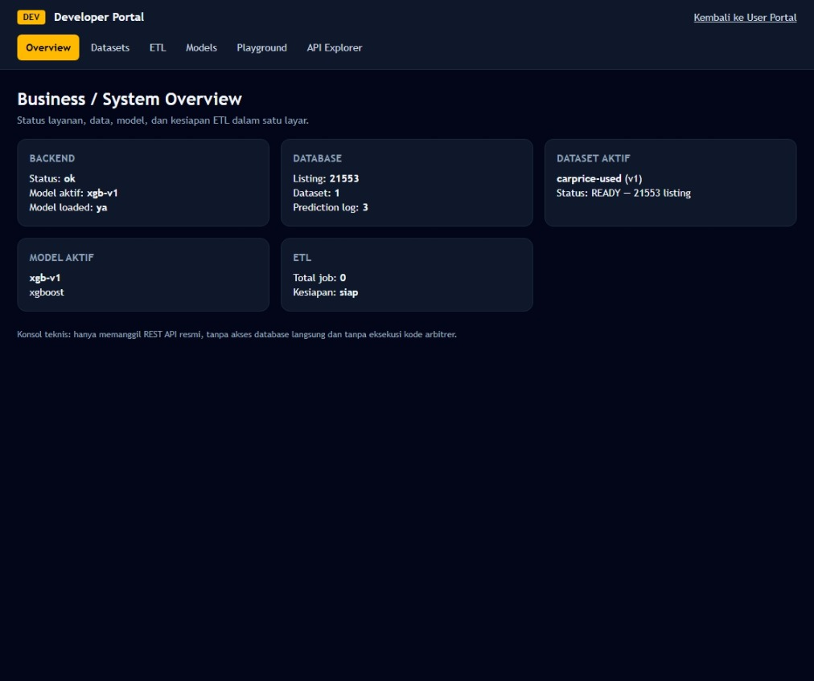

Gambar 4.13 Modul Business/System Overview Developer Portal

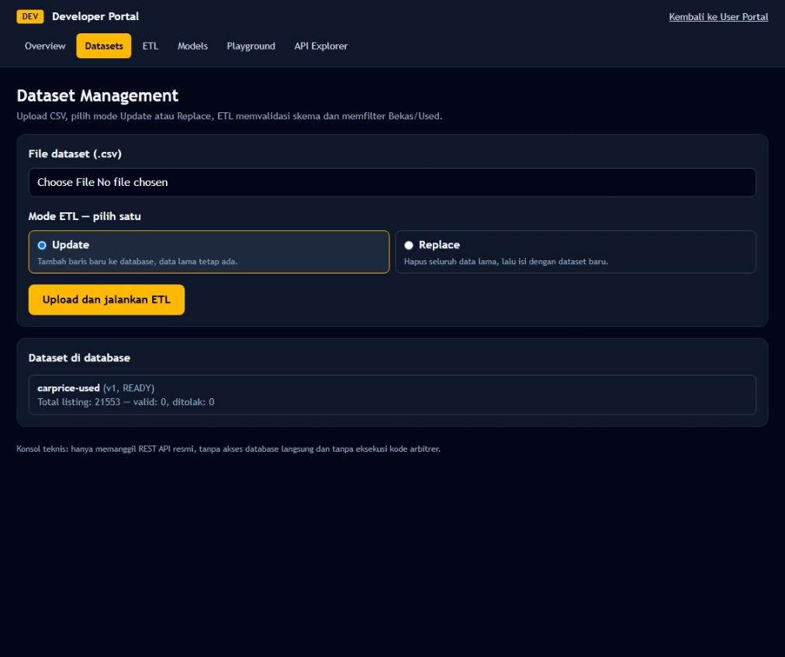

Gambar 4.14 Modul Dataset Management Developer Portal

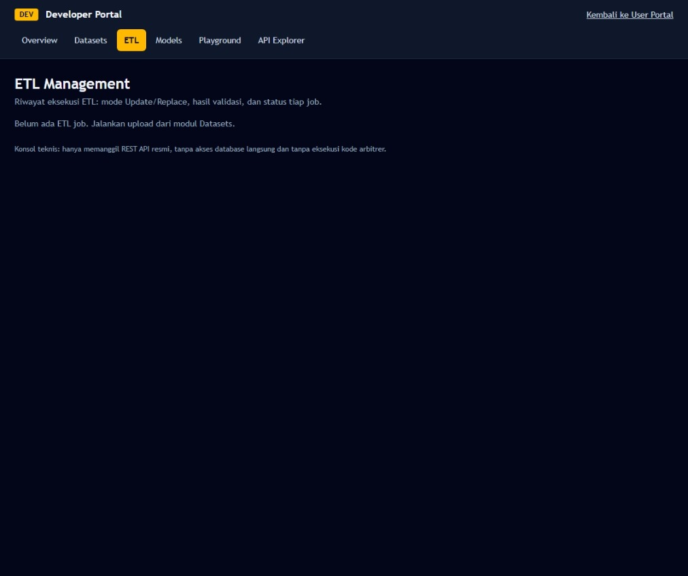

Gambar 4.15 Modul ETL Management Developer Portal (keadaan kosong sebelum ETL pertama)

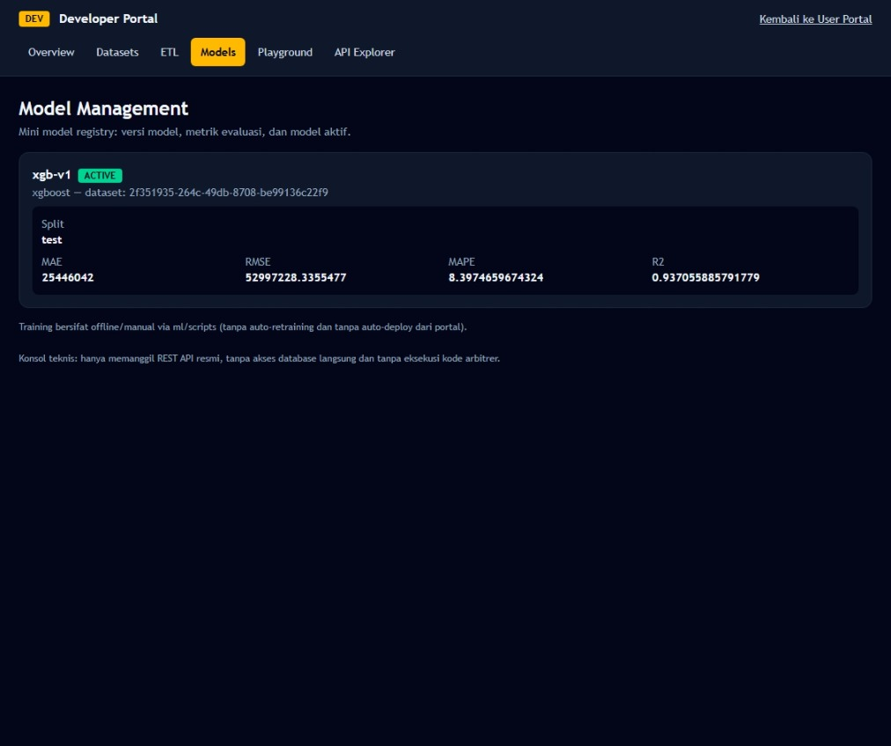

Gambar 4.16 Modul Model Management Developer Portal

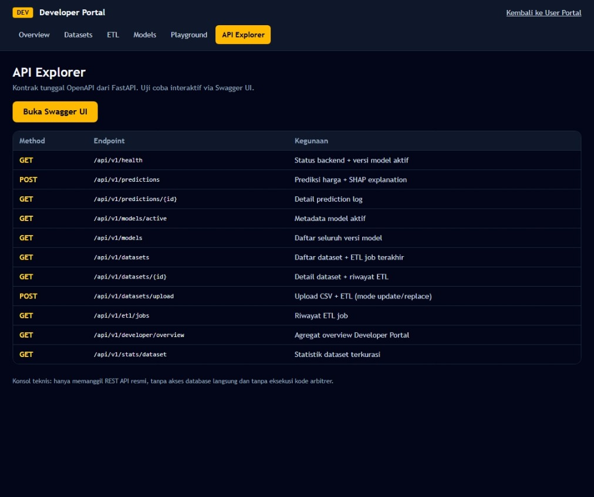

Gambar 4.17 Modul API Explorer Developer Portal

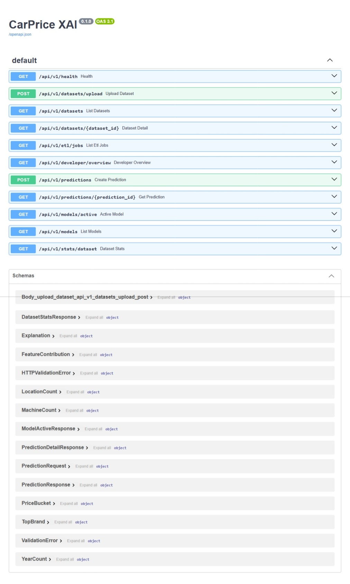

Gambar 4.18 Dokumentasi interaktif Swagger UI pada `/docs`

#### 3. Standar Desain dan Aksesibilitas
- *Adaptasi Responsif*: Antarmuka secara dinamis menyesuaikan diri terhadap ukuran
  layar. Pada tampilan desktop, sistem menggunakan navigasi sidebar statis. Pada
  tampilan ponsel pintar (*mobile* $\le 768	ext{px}$), sistem beralih menggunakan
  menu *hamburger* dan bilah navigasi bawah (*bottom bar*).
- *Nol Karakter Emoji*: Seluruh elemen grafis, tombol tindakan, dan indikator status
  menggunakan ikon SVG inline dan lencana tipografi yang bersih.
- *Aksesibilitas Tinggi*: Memenuhi rasio kontras visual standar WCAG AA, mendukung
  navigasi penuh menggunakan papan ketik (*keyboard-friendly*), serta menyediakan
  status penanganan formulir yang informatif (keadaan kosong, pemuatan, dan error).

### 4.5.3 Pengujian Produk

Pengujian komprehensif sistem dieksekusi secara resmi pada 13 Oktober 2026 (pada
commit `e96a380`) dengan hasil evaluasi akhir **verdict GO**. Seluruh kategori
pengujian berhasil diselesaikan dengan status 100% PASS tanpa kegagalan (0 FAIL)
dan tanpa pengabaian pengujian (0 SKIPPED), sebagaimana disajikan pada Tabel 4.11.

Tabel 4.11 Hasil eksekusi pengujian resmi sistem (13 Oktober 2026)

| Kategori | Status | Bukti kunci hasil pengujian |
|---|:---:|---|
| 0. Pre-task Validation | PASS | Working tree git bersih, kepatuhan batas lingkungan terverifikasi |
| 1. Data Validation | PASS | 22.679 baris mentah, 21.553 baris Bekas/Used, 0 nilai null, 0 duplikat, 8 kasus uji aturan ETL lolos, korelasi jarak tempuh 0,998979 |
| 2. Unit Testing | PASS | 17 unit test Pytest lolos dalam 1,29 detik, kompilasi statis `compileall` bersih, pemformat moneter `formatCurrency.js` valid |
| 3. Integration Testing | PASS | Endpoint health, predictions, models, dataset, etl, dan stats mengembalikan HTTP 200; penolakan berkas dan mode invalid mengembalikan HTTP 400; isolasi port 80 dan port 8081 terkonfirmasi |
| 4. Functional Testing | PASS | Build produksi Vite multi-page selesai dalam 1,37 detik, chunk modul developer (16,5 KB) terisolasi penuh, 0 karakter emoji, use case UC1 sampai UC12 tervalidasi |
| 5. Model & XAI Validation | PASS | 6 berkas artefak model terverifikasi utuh, pelatihan ulang reproducible dengan seed 42 menghasilkan $R^2 = 0,9364$ dan $	ext{MAPE} = 8,19\%$, selisih residu aditivitas Tree SHAP $\le 	ext{Rp116}$, latensi inferensi maksimum 14,5 ms |
| TOTAL KESELURUHAN | PASS | 6 dari 6 kategori PASS (0 FAIL, 0 SKIPPED) |

#### Matriks Pengujian Explainability (Tree SHAP)
Pengujian kebenaran kalkulasi Tree SHAP native dievaluasi pada lima skenario masukan
spesifikasi kendaraan yang mewakili variasi data operasional, seperti dirangkum
pada Tabel 4.12. Nilai dasar rata-rata (*base value*) yang dihasilkan model secara
konsisten bernilai Rp313.736.320.

Tabel 4.12 Matriks hasil evaluasi aditivitas dan latensi Tree SHAP pada lima skenario

| Skenario pengujian | Karakteristik input kendaraan | Hasil estimasi harga | Residu aditivitas | Waktu eksekusi |
|---|---|---:|---:|---:|
| Skenario 1 (Tipikal) | Honda City 2021, Matic, Jakarta, KM 45.000 | Rp215.566.928 | Rp70,25 | 14,52 ms |
| Skenario 2 (KM Ekstrem) | Toyota Avanza 2015, Manual, Jabar, KM 350.000 | Rp158.925.200 | Rp116,00 | 5,58 ms |
| Skenario 3 (Tahun Tua) | Toyota Corolla 1975, Manual, Jateng, KM 180.000 | Rp85.211.360 | Rp5,50 | 6,69 ms |
| Skenario 4 (Kategori Asing) | Merek/Tipe baru di luar dataset latih | Rp688.307.712 | Rp33,00 | 8,26 ms |
| Skenario 5 (Fallback KM) | Daihatsu Xenia 2018 (`km_1` null, `km_2` 60.000) | Rp125.330.320 | Rp52,50 | 5,29 ms |

Seluruh skenario pengujian membuktikan bahwa selisih residu antara estimasi model dan
penjumlahan kontribusi Tree SHAP ($	ext{Base Value} + \sum \phi_i$) berada pada rentang
Rp5,50 hingga Rp116,00. Selisih kecil ini sepenuhnya berasal dari batas presisi numerik
bilangan pecahan *float32* pada pustaka C++ XGBoost, dan berada jauh di bawah toleransi
maksimum yang dipersyaratkan yaitu Rp1.000. Waktu komputasi inferensi dan kalkulasi
penjelasan berada di bawah 15 milidetik, memenuhi batas waktu maksimal 10 detik.

#### Evaluasi Metrik Kinerja Model
Pipeline pelatihan model aktif `xgb-v1` pada data uji menghasilkan skor metrik
yang disajikan pada Tabel 4.13.

Tabel 4.13 Metrik evaluasi model `xgb-v1` pada data uji (*test set*)

| Mean Absolute Error (MAE) | Root Mean Squared Error (RMSE) | Mean Absolute Percentage Error (MAPE) | Koefisien Determinasi ($R^2$) |
|---:|---:|---:|---:|
| Rp25.446.042 | Rp52.997.228 | 8,40% | 0,9371 |

#### Pemenuhan Kriteria Penerimaan Sistem
Berdasarkan hasil pengujian terpadu, seluruh 15 butir kriteria penerimaan produk
dinyatakan terpenuhi secara lengkap:
- [x] Dataset dimuat dan divalidasi kebersihannya (21.553 baris Bekas/Used, 0 nilai hilang).
- [x] Pipeline prapemrosesan reproducible terintegrasi seragam antara pelatihan dan inferensi.
- [x] Model XGBoost terlatih dan tersimpan dalam bundel artefak terversi (`xgb-v1`).
- [x] Prediksi pada data uji menghasilkan evaluasi lengkap (MAE, RMSE, MAPE, $R^2$).
- [x] Penjelasan fitur Tree SHAP lokal terverifikasi sifat aditivitas matematisnya.
- [x] Endpoint REST API prediksi dan penjelasan fitur berjalan dengan stabil.
- [x] Endpoint unggah dataset dan ingestion ETL beroperasi dalam mode Update dan Replace.
- [x] Endpoint metadata katalog model aktif dan riwayat performa beroperasi normal.
- [x] Endpoint diagnosa kesehatan sistem untuk pengembang berfungsi dengan baik.
- [x] User Portal ReactJS berhasil mengirimkan input dan menyajikan visualisasi harga dan SHAP.
- [x] Developer Portal menyediakan enam modul operasional lengkap.
- [x] Developer Portal terisolasi penuh pada port loopback tanpa kebocoran kode ke bundle publik.
- [x] Basis data relasional PostgreSQL 16 berhasil menyimpan metadata, riwayat ETL, dan log prediksi.
- [x] Seluruh ekosistem layanan beroperasi secara otomatis melalui perintah `docker compose up`.
- [x] Identitas versi model (`model_version`) tercatat dan dapat ditelusuri dari setiap respons prediksi.

### 4.5.4 Deployment dan Konfigurasi Lingkungan

Sistem dideploy menggunakan arsitektur berbasis kontainer Docker Compose yang
mengorkestrasi lima layanan dalam satu jaringan privat:

```text
Pengguna Publik (Jaringan Host)
  |
  v
http://<host>:80 (Nginx Publik)
  |-- /        -> Antarmuka User Portal (index.html)
  |-- /api/    -> Layanan Backend FastAPI (:8000)
  (Akses ke developer.html dan aset developer diblokir HTTP 404)

Pengembang (Localhost / Loopback 127.0.0.1)
  |
  v
http://localhost:8081 (Nginx Loopback)
  |-- /            -> Antarmuka Developer Portal (developer.html)
  |-- /api/        -> Layanan Backend FastAPI (:8000)
  |-- /docs        -> Dokumentasi Interaktif Swagger UI
  |-- /openapi.json -> Spesifikasi Kontrak OpenAPI
  (Akses ke index.html diblokir HTTP 404)

Backend FastAPI -> Basis data PostgreSQL (:5432, jaringan privat internal)
Backend FastAPI -> Volume berkas artefak model (bind-mount read-only)
Pengelola Data  -> pgAdmin 4 pada port host :5050 (mode desktop lokal)
```

#### Pengelolaan Variabel Lingkungan
Konfigurasi operasional sistem sepenuhnya dikendalikan melalui variabel lingkungan
pada berkas `.env` (dengan panduan templat pada `.env.example`) tanpa ada nilai yang
dikodekan langsung ke dalam kode sumber:
- **Mode Default (Pengembangan Lokal Passwordless)**: Mengaktifkan parameter
  `POSTGRES_HOST_AUTH_METHOD=trust` dan `PGADMIN_CONFIG_SERVER_MODE=False`, sehingga
  layanan basis data dan pgAdmin dapat langsung digunakan tanpa memasukkan kata sandi.
- **Mode Produksi (Keamanan Penuh)**: Menetapkan kata sandi terenkripsi pada
  `POSTGRES_PASSWORD`, menggunakan metode autentikasi `scram-sha-256`, menyamakan string
  koneksi pada `DATABASE_URL`, serta mengembalikan pgAdmin ke mode login multi-pengguna.
- **Variabel Utama Sistem**: Mengatur parameter `MODEL_DIR`, `MODEL_VERSION`,
  `INFERENCE_TIMEOUT_S`, `MAX_UPLOAD_MB`, `SEED_ON_STARTUP`, `CORS_ORIGINS`, serta
  parameter batas validasi data (`MIN_YEAR`, `MAX_YEAR`, `MAX_KM`).

#### Prosedur Eksekusi Operasional
Sistem dapat dijalankan dengan instruksi standar Docker Compose:

```bash
# 1. Menyiapkan berkas variabel lingkungan (opsional, default telah siap pakai)
cp .env.example .env

# 2. Membangun dan menjalankan kelima kontainer di latar belakang
docker compose up -d --build

# 3. Memeriksa status kesehatan kontainer
docker compose ps
```

Daftar tautan akses layanan setelah deployment aktif:
- User Portal publik: `http://localhost/`
- Halaman kalkulasi estimasi: `http://localhost/#/prediksi`
- Developer Portal (akses khusus loopback): `http://localhost:8081/`
- Dokumentasi interaktif Swagger UI: `http://localhost:8081/docs`
- Pemeriksaan kesehatan API: `http://localhost/api/v1/health`
- Konsol administrasi basis data pgAdmin 4: `http://localhost:5050`

### 4.5.5 Pemeliharaan dan Keterbatasan Produk

#### Strategi Pemeliharaan dan Pelatihan Ulang Model
Pemeliharaan sistem berpusat pada konsistensi artefak terversi. Apabila di masa
mendatang terdapat penambahan data transaksi listing baru melalui Developer Portal,
alur pemeliharaan model dilakukan melalui prosedur terkendali:
1. Pengecekan riwayat data pada tabel `listings` menggunakan endpoint `/stats/dataset`.
2. Pelatihan ulang model secara offline menggunakan skrip `ml/scripts/train_baseline.py`
   dengan menyimpan artefak ke direktori versi baru (misalnya `xgb-v2`).
3. Pengujian validasi metrik evaluasi menggunakan suite pengujian `5_model_xai_validation.py`.
4. Pembaruan variabel lingkungan `MODEL_VERSION=xgb-v2` pada berkas `.env` tanpa
   perlu merombak struktur kode program backend maupun frontend.

#### Keterbatasan Produk Capstone Project
Sebagai prototipe *proof-of-concept*, sistem memiliki batasan operasional yang
perlu diperhatikan:
1. **Model Tunggal**: Sistem menggunakan algoritma tunggal XGBoost Regressor.
   Eksplorasi algoritma lain seperti Random Forest, LightGBM, CatBoost, maupun
   pembobotan ansambel Voting Regressor ditunda ke tahap Tugas Akhir.
2. **Kompilasi Pustaka SHAP pada Lingkungan Lokal**: Library Python `shap` mengalami
   kendala kompilasi C++ pada sistem operasi Windows dengan versi Python 3.13 lokal.
   Kendala ini berhasil dimitigasi secara arsitektural dengan memanfaatkan fitur
   perhitungan kontribusi pohon internal XGBoost (`pred_contribs=True`), sehingga
   backend tidak bergantung pada pustaka `shap` saat melayani permintaan inferensi.
3. **Mekanisme Keamanan Pengembang**: Pembatasan akses Developer Portal mengandalkan
   pengikatan port pada antarmuka *loopback* lokal dan pemisahan *entry bundle* web,
   bukan sistem autentikasi multi-peran berbasis token (JWT/OAuth2). Penerapan sistem
   keamanan pengguna bertingkat direncanakan untuk pengembangan sistem produksi skala
   penuh berikutnya.
